# Claude Codex Usage Companion for Linux

[](https://github.com/ychsieh95/claude-codex-usage-companion/actions/workflows/ci.yml) [](https://github.com/ychsieh95/claude-codex-usage-companion/releases/latest) [](LICENSE)   [](#snap-package)

[繁體中文（zh-tw）](README.zh-TW.md) · [简体中文（zh-cn）](README.zh-CN.md)

Claude Codex Usage Companion is a local, open-source usage monitor for Claude Code and Codex on Linux. It has these features:

- A small desktop panel that uses Avalonia and stays above other windows.
- A CLI for scripts, single results, JSON output, and continuous updates.
- Codex `SessionStart` and `Stop` hooks that start or refresh one resident GUI process.
- Claude Code and Codex usage in one panel. Both providers are enabled by default. Settings can disable each provider separately.
- Usage text in English, Traditional Chinese, and Simplified Chinese.
- Settings for language, theme, window position, alerts, notifications, logging, icons, automatic startup, and window behavior.
- Four tray icon styles: original, Claude session remaining, Claude weekly remaining, and Codex session remaining.
- No telemetry. The app renews existing Claude credentials in their original file. The app never writes tokens to logs.

This Linux version is based on [gkfriend/codex-usage-companion](https://github.com/gkfriend/codex-usage-companion). The original application uses Windows and WPF.

## Panel design

Under **Settings → Appearance**, select a **Design** for the panel:

- **Latest** (default) matches the Plasma widget popup. Each provider has a card with a colored edge. Each limit shows its name, a reset countdown with the local reset time, and a thin bar. A large percentage on the right, in a monospaced font, is as tall as the name, reset time, and bar together. A line separates the credits from the limits. The heading shows the last update time and a badge with the lowest remaining limit. Move the pointer over the badge to see which limit it is.
- **Previous** restores the v0.1.5 panel with the labelled 36-pixel bars.
- **Rings** shows each provider as a circular progress ring that fills with the remaining share. If both limits of a provider are shown, the outer ring is the current or 5-hour limit and the inner, lighter ring is the weekly limit. Both percentages appear in the center. Each limit's name and reset countdown sit to the right, next to a colored bar that matches its ring. The panel is narrower than in the latest design, and the heading has no badge. The Claude card always shows its credit status.

Select **OK** or **Apply** to change the design.

In the latest design, **Limit rows** can show each limit's name and reset time on one row. This makes the panel shorter. By default, the reset time is on a second row below the name.

The even-pace pointer appears in all designs. In the latest design, it is a dot on the bar. In the rings design, it is a dot on the ring. Move the pointer over the dot to see if you are ahead of an even pace. The two gap settings and the card resize handles apply only to the previous design.

## v0.1.3

The panel uses provider headings and rounded bars based on [QuotaGem](https://github.com/gyozalab/QuotaGem). Each row shows the 5h/Weekly label, remaining percentage, and local reset time. The columns stay aligned. If you hide a provider, the panel fits its content and keeps its configured screen position. Move the pointer over a weekly bar to see credit details.

Each bar has an even-pace pointer: small ticks on its top and bottom edges that mark where the bar would end if you spread usage evenly across the reset window. If the bar ends before the pointer, you are using that limit faster than an even pace. Move the pointer over the ticks to see how much of the window has passed. The latest designs of the panel and the expanded Plasma widget show it as a dot on the bar instead. To hide it, clear **Show even-pace pointer on bars** under **Usage** in Settings, or clear **Show even-pace marker** next to **Popup** in the widget configuration.

Settings has a sidebar with these pages: **Usage → Appearance → Window and startup → Notifications → Date and time → Logging → Updates**. Select a page in the sidebar to show its settings. Each page shows a label column on the left and the controls on the right. **Window position** is on the **Window and startup** page. The version and the project links are on the **Updates** page.

The app saves the selected page when Settings closes, including after **Cancel**. Settings opens on this page again, also after the app restarts. **Cancel** discards form changes that you have not applied.

Under **Appearance**, set these values:

- Background color: `#RRGGBB` or `#AARRGGBB`. An empty field uses the theme color.
- Design: **Latest**, **Previous**, or **Rings**. The default is **Latest**.
- Limit rows: show the name and reset time of each limit on one row. The default is off. This applies only to the **Latest** design.
- Header badge: the value in the heading badge of the **Latest** design. Select **Lowest remaining limit** (default), **Average of shown limits**, **Claude (lowest remaining)**, **Claude: current session**, **Claude: weekly**, **Claude: average**, **Codex (lowest remaining)**, **Codex: 5-hour**, **Codex: weekly**, **Codex: average**, or **Hidden**. Click the badge on the panel to switch quickly.
- Badge average: how the badge's average choices combine limits. **Plain average** (default) counts every limit the same. **Weighted by time to reset** counts a limit that refills soon less. **Weighted by window length** counts weekly limits more than 5-hour ones. **Gap from even pace** shows remaining percent minus the share of the window still to come, as signed points: above 0 means you're using less than an even pace. The badge's click menu also has these choices, under **Badge average**.
- Gap between the label and percentage: 0–300 pixels. The default is **128**.
- Gap between the percentage and reset time: 0–64 pixels. The default is **16**.

Appearance changes appear immediately. Select **OK** or **Apply** to save them. Select **Cancel** to restore the saved appearance. The app keeps existing saved spacing values.

Under **Settings → Updates**, select **Check for updates** to check for a newer stable GitHub release. If a newer version is available, select **Open release page** to open its download page.

**Automatically check for updates (startup and daily)** is enabled by default. The app checks at startup and every 24 hours while it runs. To disable automatic checks, clear the checkbox. Then select **OK** or **Apply**. Manual checks remain available.

Automatic checks show a desktop notification when a newer version is available. Settings shows network errors from manual checks. The app writes network errors from automatic checks to its log.

### Automatic install

When a check finds a newer version, **Install update** appears next to **Check for updates**. To install updates without selecting it, select **Automatically download and install updates**. Then select **OK** or **Apply**. This option is off by default. It requires **Automatically check for updates**.

What happens depends on how you installed the app. Settings shows a note for your installation below the options.

| Installation | Behavior |
| --- | --- |
| Portable archive in a folder you can write to, such as `~/.local/bin` | The app downloads the update, replaces its file, and restarts. It does not ask for a password. |
| Debian package | The app downloads the update in the background. A notification asks you to install it. Select **Install now** to enter your administrator password. The app installs the package with `pkexec apt-get install`. Then it restarts. |
| Snap | The app cannot replace files that snapd owns. Open the release page to update manually. |
| Codex plugin | Codex manages plugin updates. |

The app installs an update only when its package passes two checks:

1. The `SHA256SUMS` file in the release has a valid signature from the project's release key. The app includes the public key, so a changed release or a different key fails this check.
2. The SHA-256 hash of the downloaded package matches its entry in the signed `SHA256SUMS`.

Releases before v0.2.1 have no signature, so the app does not install them automatically. Downloads go to `${XDG_CACHE_HOME:-$HOME/.cache}/claude-codex-usage-companion/updates`. The app keeps only the latest download. If an update fails, a notification links to the release page. The app writes the error to its log.

To check a downloaded release manually, run these commands in the download folder. Save the [public key](packaging/update-signing-key.pub.pem) there first.

```bash
openssl dgst -sha256 -verify update-signing-key.pub.pem -signature SHA256SUMS.sig SHA256SUMS
sha256sum --check --ignore-missing SHA256SUMS
```

If you hide a provider's bars, its usage checks continue. To stop its usage checks, clear **Enable Claude usage** or **Enable Codex usage**. This also clears that provider's errors.

Errors from enabled providers stay visible until the provider recovers. Hidden bars and successful updates from another provider do not clear these errors. See the [changelog](CHANGELOG.md) for all release notes.

Usage cards have 36-pixel progress bars. Weekly cards have extra space below the bars for credits and automatic reload information. Cards grow to fit larger fonts. Resize marks appear when the pointer is over them or they have keyboard focus.

The app replaces unchanged 78/96-pixel default card heights with smaller heights. It keeps heights that you changed manually.

The app applies saved gaps from the first display, including while usage loads. The percentage column fits its text and spacing. Changes to either gap adjust the panel width. If you widen the panel manually, extra space appears before the percentage column. The reset-time column stays near the right edge. Preset positions use the desktop working area to avoid reserved taskbars and panels.

Select **Reset to defaults** to open a **Yes/No** confirmation. Select **Yes** to restore all preferences in the settings form, including card heights and spacing. Select **No** to keep the form unchanged. Escape and closing the confirmation also keep the form unchanged.

Select **OK** or **Apply** to save the reset. Select **Cancel** to discard it. The selected page stays the same. Changes to card height also change the height of the progress track and fill.

Before it opens, the window fits all visible cards and the status line. The bottom has only the normal inset. After the first usage result, the panel adjusts the columns that contained the waiting text. It keeps the configured gaps, which default to 128 and 16 pixels.

## Screenshots

| Design | English (`en-US`) | Traditional Chinese (`zh-tw`) | Simplified Chinese (`zh-cn`) |
| --- | --- | --- | --- |
| Latest (default) | 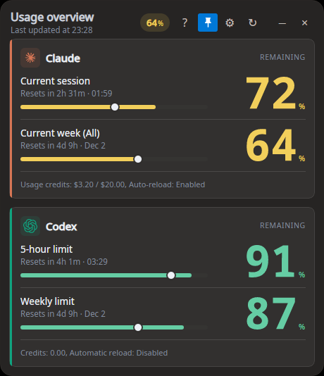 | 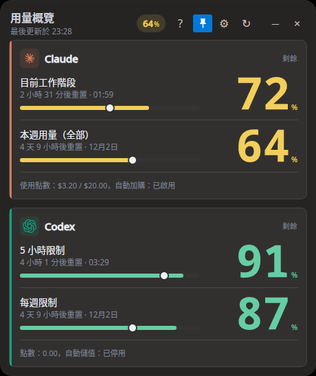 | 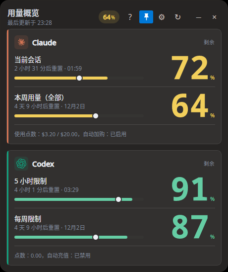 |
| Previous (v0.1.5) | 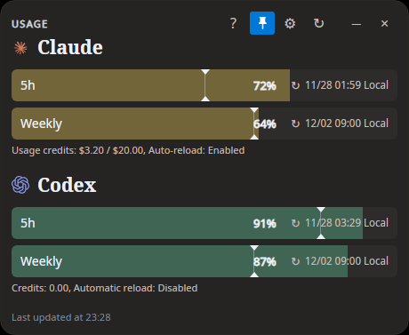 | 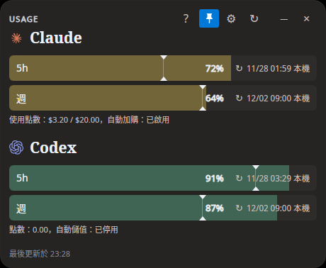 | 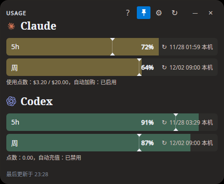 |
| Rings | 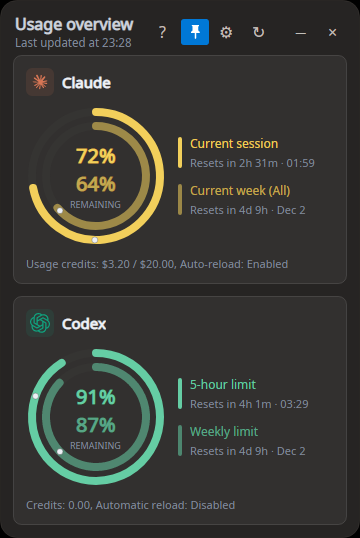 | 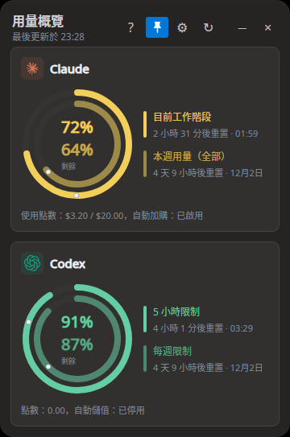 | 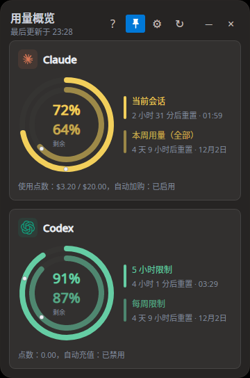 |

The panel images use sample usage data. To switch designs, use **Settings → Appearance → Design**.

### Settings

| English (`en-US`) | Traditional Chinese (`zh-tw`) | Simplified Chinese (`zh-cn`) |
| --- | --- | --- |
| 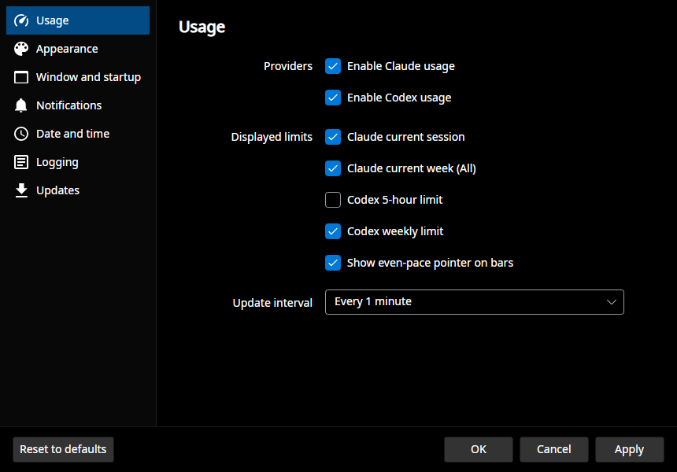 | 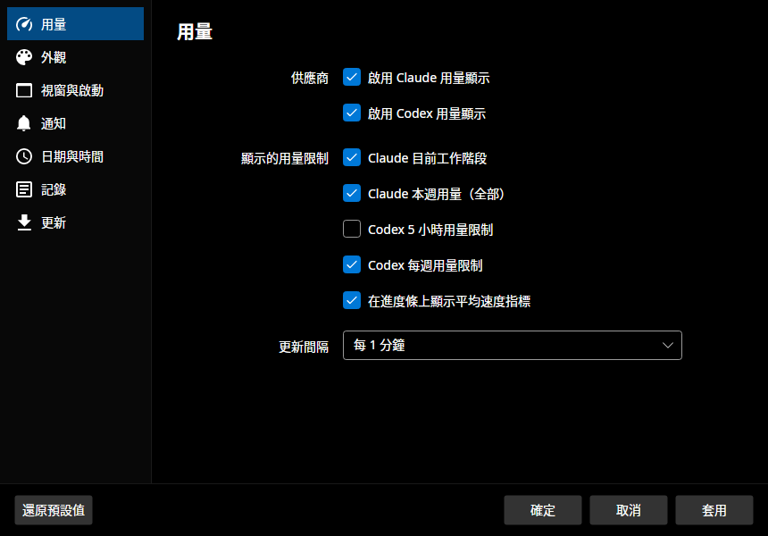 |  |

### Reset confirmation

The **Yes/No** labels are centered horizontally and vertically in their buttons. Screenshot generation requires the .NET 10 SDK. To generate the panel, settings, and confirmation images, run `bash scripts/capture-screenshots.sh`.

| English (`en-US`) | Traditional Chinese (`zh-tw`) | Simplified Chinese (`zh-cn`) |
| --- | --- | --- |
|  |  |  |

### Plasma 6 widget

| Design | Panel | Expanded popup |
| --- | --- | --- |
| Latest (default) | 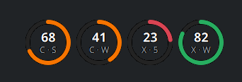 |  |
| Previous |  |  |


## Requirements

- Kubuntu 26.04 or another modern Linux distribution. Release packages are for x64. For ARM64, build from source. See [Build](#build).
- A Wayland desktop or an X11 session.
- Codex CLI installed, authenticated, and available as `codex` on `PATH`.
- These host libraries: `libx11-6`, `libice6`, `libsm6`, `libfontconfig1`, `libharfbuzz0b`, `fonts-noto-cjk`, and `libnotify-bin`.

The `.deb` installs the host libraries automatically. For the snap and the portable archive, install them with this command:

```bash
sudo apt install libx11-6 libice6 libsm6 libfontconfig1 libharfbuzz0b fonts-noto-cjk libnotify-bin
```

Release packages include the .NET runtime. You do not need a separate .NET runtime installation.

## Install and verify Codex CLI

The app requires the official Codex CLI and its `app-server` subcommand. To install or update Codex CLI on Linux, use the [official installer](https://developers.openai.com/codex/cli):

```bash
curl -fsSL https://chatgpt.com/codex/install.sh | sh
```

After installation, open a new terminal. Sign in with ChatGPT or another available authentication method:

```bash
codex login
```

Verify the executable path, version, authentication, and required `app-server` subcommand:

```bash
command -v codex
codex --version
codex login status
codex app-server --help >/dev/null && echo "Codex app-server is available"
```

The commands should give these results, in order:

1. The absolute path to `codex`.
2. The Codex version.
3. The active authentication method.
4. The message `Codex app-server is available`.

If `command -v codex` gives no output, open a new terminal. Make sure that `PATH` includes the installation directory shown by the installer.

The app also searches `~/.local/bin`, `~/.npm-global/bin`, and `~/.codex/bin`. If Codex is in another location, set `CODEX_CLI_PATH=/absolute/path/to/codex`.

## Enable Claude usage (optional)

The panel shows Claude Code and Codex usage by default. To use Claude usage, install [Claude Code](https://code.claude.com). Sign in to Claude Code. Run `claude` once to create `~/.claude/.credentials.json`.

If you do not use Claude Code, clear **Enable Claude usage** in Settings. You can also set `"enableClaudeUsage": false` in `settings.json`. The **Enable Codex usage** checkbox controls Codex in the same way.

Claude Code has no official usage API. The app reads the OAuth access token that Claude Code stores locally. It uses this token to call Anthropic's undocumented usage endpoint.

The access token lasts a few hours. Claude CLI renews it only while the CLI runs. After a restart of the computer, the stored token is usually expired.

The app renews the token with the OAuth refresh grant. It uses the refresh token in `~/.claude/.credentials.json`. It writes both renewed tokens to that file in one atomic operation. All other fields stay the same. The app uses the same lock file as Claude CLI to prevent simultaneous token changes. The app never writes tokens to logs.

If the refresh token has expired or been revoked, the app shows an error. Run `claude` to sign in again.

The undocumented endpoint can change without notice. The app checks Claude usage at most once every 180 seconds, regardless of the update interval.

The app searches `~/.local/bin`, `~/.npm-global/bin`, and `~/.claude/local` for Claude CLI. If your credential file or CLI is in another location, set the applicable variable:

- `CLAUDE_CREDENTIALS_PATH=/absolute/path/to/.credentials.json`
- `CLAUDE_CLI_PATH=/absolute/path/to/claude`

## Install

Download the files from the [latest release](https://github.com/ychsieh95/claude-codex-usage-companion/releases/latest). Choose one package for the app. The Plasma widget package and the Codex plugin are optional.

| Package | Root access | Menu entry | Plasma widget | Use it when |
| --- | --- | --- | --- | --- |
| [Debian package](#debian-package) (`.deb`) | Yes | Yes | Included | You use Debian, Ubuntu, or Kubuntu. |
| [Snap package](#snap-package) (`.snap`) | Yes | Yes | Separate | Your distribution has snapd. |
| [Portable archive](#portable-archive) (`.tar.gz`) | No | No | Separate | You do not want to install a system package. |
| [Plasma widget package](#plasma-widget-package) (`.plasmoid`) | No | — | Widget only | You use the snap or the portable archive. |
| [Codex plugin](#codex-plugin) (`.zip`) | No | No | No | You want Codex to start and refresh the app. |

To verify the downloaded files, download `SHA256SUMS` to the same directory. Then run:

```bash
sha256sum --check --ignore-missing SHA256SUMS
```

Each downloaded file must show `OK`.

### Debian package

Install the package with this command:

```bash
sudo apt install ./claude-codex-usage-companion_0.2.1_amd64.deb
```

The package installs these items:

- The `claude-codex-usage-companion` command and the shorter `claude-codex-usage` alias.
- A KDE/GNOME application menu entry at `/usr/share/applications/claude-codex-usage-companion.desktop`.
- The icon under `/usr/share/icons/hicolor/scalable/apps/`.
- The Plasma 6 widget.

### Snap package

Install the package with this command:

```bash
sudo snap install --classic --dangerous ./claude-codex-usage-companion_0.2.1_amd64.snap
```

The `--dangerous` flag is necessary because the file does not come from the Snap Store.

The snap uses classic confinement. The app must read and renew Claude credentials in `~/.claude`. It must also read `~/.codex`, start the `codex` CLI, write the autostart entry, and call `notify-send`. Strict confinement blocks these actions.

The snap installs the `claude-codex-usage-companion` command in `/snap/bin`. It also adds an application menu entry. To add the shorter `claude-codex-usage` alias, run:

```bash
sudo snap alias claude-codex-usage-companion claude-codex-usage
```

The snap includes the Plasma widget package, but does not install it. To install the widget, run:

```bash
kpackagetool6 --type Plasma/Applet --install /snap/claude-codex-usage-companion/current/usr/share/plasma/claude-codex-usage-companion-0.2.1.plasmoid
```

If you enable automatic startup, the autostart entry uses `/snap/bin/claude-codex-usage-companion`. This path stays the same after snap updates.

### Portable archive

Extract the archive. Copy the app to a directory on `PATH`:

```bash
tar -xzf claude-codex-usage-companion-0.2.1-linux-x64.tar.gz
cd claude-codex-usage-companion-0.2.1-linux-x64
install -D -m 755 claude-codex-usage-companion ~/.local/bin/claude-codex-usage-companion
```

Make sure that `PATH` includes `~/.local/bin`. The Plasma widget calls the app from `PATH`.

The archive also contains the Plasma widget package, the READMEs, and the license. It does not add a menu entry or the `claude-codex-usage` alias.

The autostart entry uses the path of the app file. If you move the file, disable and enable automatic startup again.

### Plasma widget package

Use this package with the snap or the portable archive. Do not use it with the `.deb`, because the `.deb` already includes the widget. Install the package without root access:

```bash
kpackagetool6 --type Plasma/Applet --install ./claude-codex-usage-companion-0.2.1.plasmoid
```

To update an installed widget, use `--upgrade` instead of `--install`. The widget requires the `claude-codex-usage-companion` command on `PATH`.

### Codex plugin

The Linux release build creates `CodexUsageCompanionMarketplace-v0.2.1-linux-x64.zip`. Extract this file. Add the extracted marketplace with this command:

```bash
codex plugin marketplace add /path/to/extracted-marketplace
```

Install the plugin from the added marketplace. Enable the plugin. When Codex asks, review the included `SessionStart` and `Stop` hooks. Trust the hooks to enable them. When the plugin starts the app, the app uses `PLUGIN_DATA` for settings.

The plugin contains its own copy of the app. It does not add a menu entry, a command on `PATH`, or the Plasma widget.

### Uninstall

Disable automatic startup in Settings first. Then use the command for your package:

```bash
sudo apt remove claude-codex-usage-companion      # Debian package
sudo snap remove claude-codex-usage-companion     # Snap package
rm ~/.local/bin/claude-codex-usage-companion      # Portable archive
kpackagetool6 --type Plasma/Applet --remove com.github.ychsieh95.claude-codex-usage-companion  # Plasma widget package
```

These commands keep your settings and logs. To remove them, delete `${XDG_CONFIG_HOME:-$HOME/.config}/claude-codex-usage-companion` and `${XDG_STATE_HOME:-$HOME/.local/state}/claude-codex-usage-companion`.

## Start the app

Launch **Claude Codex Usage Companion** from the application menu, or run:

```bash
claude-codex-usage-companion gui
```

Automatic startup at login is disabled by default. If you enable it in Settings, the app creates `${XDG_CONFIG_HOME:-$HOME/.config}/autostart/claude-codex-usage-companion.desktop`.

Enable automatic startup at login to show the **Minimize the window** option. Otherwise, this option stays hidden. If both options are enabled, the app starts at login with its window hidden. Usage continues to update in the background.

To show the window, open the app from the application menu. You can also use the tray icon, if enabled, or run the app again.

Select **⚙ Settings** to configure the app. Settings includes taskbar and system-tray icons, tray icon style, and automatic startup at login. It also includes language, theme, position, low-usage alerts, reset notifications, logging, and always-on-top behavior.

- **OK** saves changes and closes Settings.
- **Cancel** discards changes that you have not applied.
- **Apply** saves changes and keeps Settings open.

Under **Appearance**, set a background color with `#RRGGBB` or `#AARRGGBB`. Leave the field empty to use the theme color. Set the gap between the percentage and reset time to 0–64 pixels. Set the gap between the 5h/Weekly label and percentage to 0–300 pixels. The default gaps are 16 and 128 pixels, respectively. The gaps apply only to the **Previous** design.

The panel width adjusts to fit. Appearance changes appear immediately. Select **Cancel** to restore the last saved appearance.

## Plasma 6 widget

The `.deb` installs the **Claude Codex Usage** Plasma 6 widget. For the snap or the portable archive, install the [Plasma widget package](#plasma-widget-package). To add the widget:

1. Right-click the Plasma desktop or panel.
2. Select **Add Widgets**.
3. Search for `Claude Codex Usage`.
4. Drag the widget onto the panel or desktop.

The widget shows four limits: Claude's current session and week, and Codex's five-hour and weekly limits. All four limits are enabled by default. The selected limits appear in the panel and expanded popup.

In a horizontal panel, the indicators sit side by side. In a vertical panel, they stack. Open the widget to see local reset times, credits, update status, and errors for each provider.

The configuration page has these options:

| Option | Values | Effect |
| --- | --- | --- |
| **Design** | Latest (default), Previous | Latest is the current look. Previous restores the v0.1.5 look. **Percentages**, **Panel**, **Warn below**, **Critical below**, **Popup badge**, and **Show credits** apply to the latest design only. |
| **Style** | Radial meters, Meter strips | Circles or bars in the panel. |
| **Update every** | 1–60 minutes | How often the widget asks the app for usage. |
| **Percentages** | Remaining (default), Used | Shows how much of each limit is left or used. Colors always follow the remaining amount, so red means a limit is nearly used up. |
| **On click** | Open the popup (default), Open the companion app | What clicking the widget in the panel does. |
| **Panel** | Two checkboxes | Show only the lowest remaining (or highest used) limit instead of every selected limit, and show or hide the short labels under the panel meters. |
| **Warn below** and **Critical below** | 1–100% left (defaults 70% and 40%) | A limit turns amber below the warning level and red below the critical level. |
| **Reset time** | Countdown and time (default), Countdown, Time | How reset times appear in the popup and tooltip. With **Time**, resets more than a day away include the weekday. |
| **Clock** | System default, 12-hour, 24-hour | The clock format for reset times and the last update time. |
| **Tooltip** | Three checkboxes | Show the lowest remaining (or highest used) limit, reset times, and the last update time in the panel tooltip. |
| **Limits** | Four checkboxes | The limits shown in the panel and popup. |
| **Popup badge** | Most-used limit (default), Average of shown limits, Claude's most-used limit, Codex's most-used limit, Hidden | The value in the popup header badge. The most-used limit is the lowest remaining (or highest used) limit. The average covers the shown limits. Move the pointer over the badge to see what it shows. |
| **Popup** | Two checkboxes | Show the credits line under each provider and the even-pace marker on its bars. |

The widget calls the app's local `status --json` command. The app handles credentials and network access.

For a development checkout, install or update the current source package with `bash scripts/install-plasma-widget.sh`. The companion CLI must remain installed and available on `PATH`.

## CLI

The examples use the `claude-codex-usage` alias. If you do not have the alias, use `claude-codex-usage-companion`.

Print current limits:

```bash
claude-codex-usage status
```

Return machine-readable JSON:

```bash
claude-codex-usage status --json
```

Continuously refresh the terminal every 30 seconds:

```bash
claude-codex-usage watch --interval 30
```

Print the settings path and effective settings:

```bash
claude-codex-usage config
```

`status`, `watch`, and their `--json` output show Claude before Codex. This matches the panel's card order. JSON results use this structure: `{"claude": {"state": ..., "error": ...}, "codex": {"state": ..., "error": ...}}`. If a provider is disabled, its key is absent. This replaces the previous flat JSON structure. Scripts that read the previous structure need changes.

If Codex is not on `PATH`, set `CODEX_CLI_PATH=/absolute/path/to/codex`. To disable ANSI colors, set `NO_COLOR=1` or use `--no-color`.

## Settings

The default settings file is:

```text
${XDG_CONFIG_HOME:-$HOME/.config}/claude-codex-usage-companion/settings.json
```

```json
{
  "showClaudeSession": true,
  "showClaudeWeekly": true,
  "showCodexFiveHour": false,
  "showCodexWeekly": true,
  "enableClaudeUsage": true,
  "enableCodexUsage": true,
  "enableSystemTray": false,
  "trayIconStyle": "original",
  "showTaskbarIcon": true,
  "enableAutoUpdateCheck": true,
  "startOnBoot": false,
  "minimizeOnStart": false,
  "language": "en-US",
  "theme": "system",
  "overlayDesign": "latest",
  "resetTimeOnNameRow": false,
  "headerBadge": "lowest",
  "confirmHideBadge": true,
  "badgeAverage": "plain",
  "settingsPage": "usage",
  "backgroundColor": "",
  "percentageTimeSpacing": 16,
  "labelPercentageSpacing": 128,
  "enableLowUsageAlert": false,
  "lowUsageAlertThresholdPercent": 20,
  "notifyOnReset": false,
  "enableUsageLogging": false,
  "usageLogFilePath": "/home/you/.local/state/claude-codex-usage-companion/usage-history.csv",
  "usageLogFormat": "csv",
  "position": "right-bottom",
  "opacity": 1.0,
  "margin": 16,
  "alwaysOnTop": true,
  "refreshIntervalSeconds": 60,
  "resetDateTimeFormat": "MMM D",
  "lastUpdatedDateTimeFormat": "HH:mm"
}
```

Language values are `en-US`, `zh-tw`, and `zh-cn`. On the first run, the app selects a language from the system culture:

- `zh-TW`, `zh-HS`, `zh-Hant`, `zh-HK`, `zh-MO`, and other Traditional Chinese cultures use `zh-tw`.
- `zh-CN`, `zh-Hans`, `zh-SG`, and other Simplified Chinese cultures use `zh-cn`.
- All other cultures use `en-US`.

The app also accepts the legacy values `auto` and `en`. Letter case does not affect language matching.

Theme values: `dark`, `light`, and `system`. `system` is the default and follows the desktop's current light or dark preference.

Design values: `latest`, `previous`, and `rings`. `latest` is the default. `resetTimeOnNameRow` puts each limit's name and reset time on one row in the latest design. The default is `false`.

Header badge values: `lowest`, `average`, `claude`, `claude-session`, `claude-weekly`, `claude-average`, `codex`, `codex-five-hour`, `codex-weekly`, `codex-average`, and `hidden`. `lowest` is the default. `claude` and `codex` show the lowest remaining limit of that provider. `average` shows the average of the shown limits, and `claude-average` and `codex-average` the average of that provider's shown limits. `claude-session`, `claude-weekly`, `codex-five-hour`, and `codex-weekly` show that one limit, even when its row is hidden. Badge average values: `plain` (default), `time-to-reset`, `window-length`, and `pace`.

Settings page values: `usage`, `appearance`, `window`, `notifications`, `dateTime`, `logging`, and `updates`. `settingsPage` stores the page that Settings shows when it opens. The app ignores the `settingsSections` value from earlier versions.

Tray icon style values are `original`, `claude-current-session`, `claude-weekly-session`, and `codex-session`. Numeric styles show bold, anti-aliased seven-segment digits on a dark background. They do not show a percent sign. Codex session uses the five-hour limit when available. Otherwise, it uses weekly usage.

Position values: `left-top`, `middle-top`, `right-top`, `left-center`, `middle-center`, `right-center`, `left-bottom`, `middle-bottom`, `right-bottom`, `custom`.

Select a position to see it immediately. Select **OK** or **Apply** to keep it. Select **Cancel** to restore the last applied position. The app also accepts legacy corner values such as `top-left` and `bottom-right`.

Drag the header to move the window freely. The app changes the position to `custom` and saves the coordinates. Select `custom` in Settings to restore the saved location. If no location is saved, the window keeps its current location.

Use these shortcuts in the main window:

- `F1`: Show the shortcut list.
- `S`: Open Settings.
- `Ctrl+R`: Refresh usage.
- `Esc`: Close the window.

The header's **?** button and the tray menu's **Keyboard shortcuts** item open the same shortcut list. Press `Esc` or `F1` to close the list. You can also select **OK**.

In Settings, press `Ctrl+S` to save changes. Press `Esc` to close Settings. If you close Settings with unsaved changes, the app asks for confirmation before it discards them.

The **Update interval** setting has common values from 1 to 60 minutes. The default and minimum are 1 minute. Previously saved custom intervals in this range remain available.

Low-usage alerts are disabled by default. When enabled, the app checks the remaining five-hour and weekly usage against the configured threshold. The threshold range is `1`–`100` percent. The app sends one desktop notification when either limit falls below the threshold. That alert becomes available again after the remaining usage returns to the threshold or higher.

Reset notifications have a separate setting and are disabled by default. The app sends them when a usage update confirms a new reset window.

Reset date/time presets are `MMM D` (default), `MMM D HH:mm`, `yyyy-MM-dd`, and `yyyy-MM-dd HH:mm`. Last-updated presets are `HH:mm` (default), `HH:mm:ss`, `MMM D HH:mm`, and `yyyy-MM-dd HH:mm`.

Both fields accept custom .NET date/time format strings. Uppercase `D` is supported as the day token. A preview uses the selected language to check the format as you type. An invalid format shows an error and disables **OK** and **Apply**. Month names and day notation use the selected language.

These settings have the following ranges:

- Opacity: `0.5`–`1.0`.
- Margin: `0`–`64` pixels.
- Update interval: `60`–`3600` seconds.

`enableClaudeUsage` and `enableCodexUsage` control each provider separately. Both default to `true`. Disabling a provider hides its section and stops its usage checks. The panel height adjusts automatically.

Claude usage checks occur at most once every 180 seconds, regardless of the update interval. See [Enable Claude usage (optional)](#enable-claude-usage-optional).

The **Displayed limits** checkboxes control individual cards:

- `showClaudeSession`: Claude current session. Visible by default.
- `showClaudeWeekly`: Claude weekly usage. Visible by default.
- `showCodexFiveHour`: Codex five-hour usage. Hidden by default to keep the previous layout.
- `showCodexWeekly`: Codex weekly usage. Visible by default.

## Usage update logging

Usage logging is disabled by default. When enabled, the app adds each successful update and update error to the configured file. The default format is CSV. The default path is `${XDG_STATE_HOME:-$HOME/.local/state}/claude-codex-usage-companion/usage-history.csv`.

The app supports these log formats:

- `txt`: One key/value record per line.
- `csv`: A header followed by data rows.
- `jsonl`: One JSON object per line.

A format change automatically changes the configured filename extension to `.txt`, `.csv`, or `.jsonl`. Relative paths use the app's XDG state directory.

Each record includes these fields:

- Update timestamp.
- Provider: `claude` or `codex`.
- Success or error status.
- Five-hour and weekly remaining percentages and reset times.
- Available reset credits.
- Any update error.

The added `provider` field changes the log structure. Parsers for previous log files can need changes.

## Build

Install the .NET 10 SDK or newer. Run this command:

```bash
bash scripts/build-linux.sh
```

For ARM64:

```bash
bash scripts/build-linux.sh linux-arm64
```

To rebuild, reinstall, and restart the installed app:

```bash
./scripts/rebuild-reinstall.sh
```

The script stops your running app and builds for the host architecture. It reinstalls the generated `.deb` with `sudo apt reinstall -f`. Then it starts the installed app. The script stops if a step fails.

Run the script as your normal desktop user. Only package installation requires sudo.

The local rebuild script disables NuGet vulnerability auditing. This prevents `NU1900` warnings when the audit service is unavailable. Downloads still require NuGet access if dependencies are not cached.

To enable auditing, run `NUGET_AUDIT=true ./scripts/rebuild-reinstall.sh`. Direct `build-linux.sh` runs and CI keep auditing enabled by default.

The build runs the test suite. It writes these files under `artifacts/`:

- A `.deb` package.
- A portable `.tar.gz` archive.
- A Plasma `.plasmoid` package.
- A Codex marketplace `.zip` archive.
- Checksums.

To also build the `.snap` package, install snapcraft with `sudo snap install snapcraft --classic`. Then run:

```bash
bash scripts/build-snap.sh
```

The script runs `build-linux.sh` first. It writes `claude-codex-usage-companion_<version>_<arch>.snap` under `artifacts/` and adds it to `SHA256SUMS`. Set `SKIP_LINUX_BUILD=true` to use an existing build. Set `SNAPCRAFT_ARGS=--destructive-mode` to build on an Ubuntu 24.04 host without LXD.

For a development run:

```bash
dotnet run --project src/CodexUsageCompanion -- status
dotnet run --project src/CodexUsageCompanion -- gui
```

## Linux behavior

The GUI uses a Unix socket under `XDG_RUNTIME_DIR` that only the owner can access. The socket permits one app instance and accepts refresh signals. Settings follow the XDG config convention. The app stores logs with a size limit under `${XDG_STATE_HOME:-$HOME/.local/state}/claude-codex-usage-companion`.

On Wayland desktops with XWayland, the app uses Avalonia's X11 compatibility backend. The configured position controls the initial window location and later position changes. With native Wayland only, the compositor controls placement and can ignore this setting. X11 sessions use the X11 backend.

Drag the header to move the panel. Drag the lower-right corner to resize it. Cards and usage bars adjust to the width. Shorter windows permit scrolling.

The header controls appear in this order: keyboard shortcuts, pin, settings, refresh, minimize, and close. A wider gap separates the minimize and close controls. The pin button controls the always-on-top setting. The **Keep window always on top** checkboxes in Settings and the tray menu control the same setting.

Claude's **Current session** and **Current week (All)** cards appear before Codex. Provider headings show the Claude or OpenAI icon. Below weekly bars, the panel shows Codex credit balance and automatic reload information. For Claude, it shows extra-usage spending and the monthly limit. These details also appear in tooltips.

The system tray is disabled by default. If the tray is disabled, closing the panel stops the app. If the tray is enabled, closing the panel hides it and keeps the latest usage data. Scheduled updates and Codex rate-limit notifications continue while the panel is hidden.

To restore the panel, select the tray icon or **Show window**, or start the app again. The panel restores its saved usage data and last screen position. It does not request new usage data immediately.

The tray menu groups these actions with separators:

- **Show window**
- **Refresh usage**
- **Keep window always on top**
- **Start automatically when I sign in**
- **Settings**
- **Keyboard shortcuts**
- **Quit**

Select **Quit** to stop the app.

The tray tooltip starts with the app name. It then shows one line for each usage window, for example:

- `[Claude] Current: d% remaining (Resets at ...)`
- `[Claude] Weekly: d% remaining (Resets at ...)`
- `[Codex] Weekly: d% remaining (Resets at ...)`

The last line is `Last updated at HH:mm`. This line uses the selected last-updated date/time format.

Drag the small handle at the bottom of a usage card to change its height. The app saves the height automatically. When the handle has keyboard focus, use the Up/Down keys to adjust it.

Under **Settings → Appearance**, drag **Panel font size** (80–150%) to see the text size. Select **Apply** or **OK** to save it. The lower-right window resize mark appears when the pointer is over it.

The app reads `account/rateLimits/read` from a local `codex app-server` process. Changes to this API in future Codex releases can require app updates. Claude usage uses an undocumented Anthropic endpoint that can change without notice. See [Enable Claude usage (optional)](#enable-claude-usage-optional).

## Documentation style

Use [ASD-STE100 Simplified Technical English](https://www.asd-ste100.org/) as the writing guide for the English README:

- Use short sentences and the active voice.
- Give one instruction in each sentence.
- Use a maximum of 20 words in procedural sentences and 25 words in descriptive sentences.
- Use the same term for the same item.
- Keep commands, paths, setting keys, and UI labels unchanged.

Use `README.md` as the source for both Chinese translations. Keep their instructions, examples, and technical details aligned with the English version.

## Privacy and license

See [PRIVACY.md](PRIVACY.md), [SECURITY.md](SECURITY.md), and the [MIT License](LICENSE).
