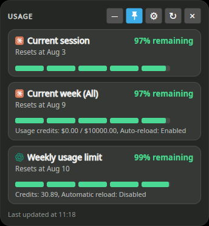
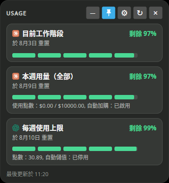
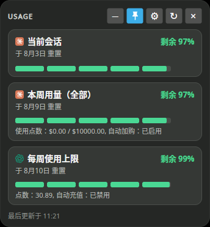
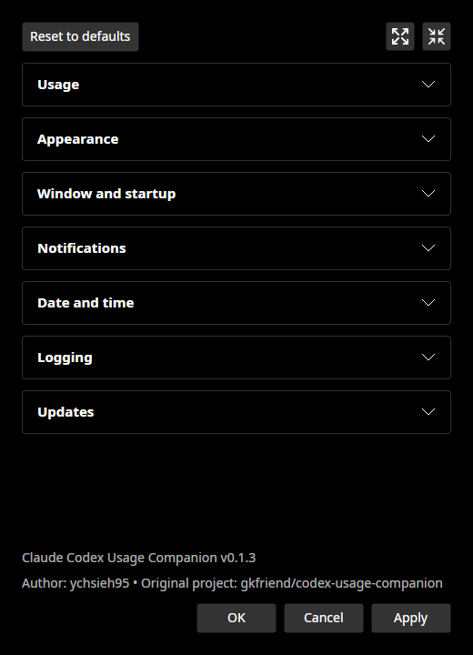
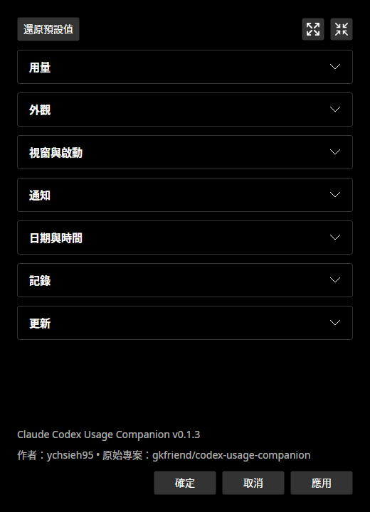
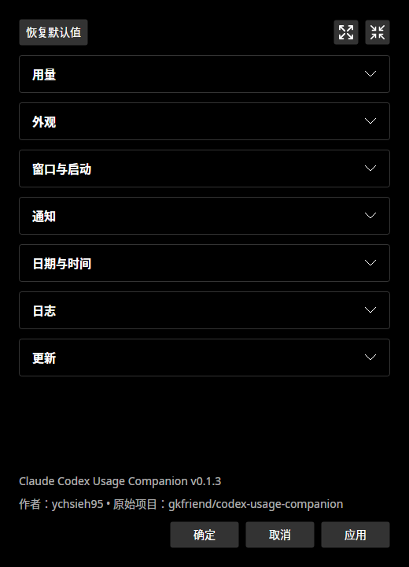

# Claude Codex Usage Companion Linux 版

[English](README.md) · [繁體中文（zh-tw）](README.zh-TW.md)

Claude Codex Usage Companion 是一款在 Linux 上运行的本地开源 Claude Code 与 Codex 用量监视器，包含：

- 使用 Avalonia 构建的小型桌面面板，可保持在其他窗口上方。
- 支持脚本、单次结果、JSON 输出和持续更新的 CLI。
- Codex `SessionStart` 和 `Stop` hooks，可启动或刷新单个常驻 GUI 进程。
- Claude Code 和 Codex 用量显示在同一面板。两者默认均启用，可在设置中分别禁用。
- 英文、繁体中文和简体中文用量文字。
- 语言、主题、窗口位置、警报、通知、日志、图标、自动启动和窗口行为设置。
- 四种系统托盘图标样式：原始图标、Claude 会话剩余用量、Claude 每周剩余用量和 Codex 会话剩余用量。
- 不含遥测。程序会在原始文件中更新现有 Claude 凭据，且不会将 token 写入日志。

此 Linux 移植版基于 [gkfriend/codex-usage-companion](https://github.com/gkfriend/codex-usage-companion)。原始实现以 Windows/WPF 为目标。

## v0.1.3

面板采用参考 [QuotaGem](https://github.com/gyozalab/QuotaGem) 的提供方标题和圆角进度条。每行显示 5h／每周标签、剩余百分比和本地重置时间，各列保持对齐。隐藏提供方时，面板会根据内容调整大小，并保留设置的屏幕位置。将鼠标指针移至每周进度条可查看点数信息。

设置分组按此顺序排列：**用量 → 外观 → 窗口与启动 → 通知 → 日期与时间 → 日志 → 更新**。点击分组标题可展开或折叠。**全部展开**和**全部折叠**可控制所有分组。

关闭设置时，程序会保存各分组的展开状态，点击**取消**也会保留。重新打开设置或重启程序时，会恢复这些状态。**取消**会丢弃尚未应用的表单更改。

在**外观**中设置以下项目：

- 背景颜色：`#RRGGBB` 或 `#AARRGGBB`。留空使用主题颜色。
- 标签与百分比间距：0–300 像素，默认 **128**。
- 百分比与重置时间间距：0–64 像素，默认 **16**。

外观更改会立即显示。点击**确定**或**应用**保存。点击**取消**恢复已保存的外观。现有间距设置会保留。

在**设置 → 更新**中，点击**检查更新**可检查是否有更新的 GitHub 稳定版本。如有新版本，点击**打开版本页面**可打开下载页面。

**自动检查更新（启动时及每天）**默认启用。程序会在启动时及运行期间每 24 小时检查一次。要禁用自动检查，请取消勾选，再点击**确定**或**应用**。仍可手动检查。

自动检查发现新版本时会显示桌面通知。请手动下载并安装更新。手动检查的网络错误会显示在设置中。自动检查的网络错误会写入日志。

隐藏提供方进度条后，用量查询仍会继续。取消勾选**启用 Claude 用量显示**或**启用 Codex 用量显示**，才会停止对应的用量查询。这也会清除该提供方的错误。

已启用提供方的错误会持续显示，直到该提供方恢复正常。隐藏进度条或其他提供方更新成功都不会清除这些错误。完整版本说明请参阅[变更日志](CHANGELOG.md)。

用量卡片使用 36 像素进度条。每周卡片在进度条下方保留额外空间，显示点数和自动充值信息。卡片会随较大字体增加高度。调整大小的标记会在鼠标悬停或获得键盘焦点时显示。

程序会将未更改的 78／96 像素默认卡片高度改为较小高度。手动调整过的高度会保留。

**全部展开**图标是四个向外箭头。**全部折叠**图标是四个向内箭头。将鼠标指针移至图标可查看提示。

程序从首次显示起就会应用已保存的间距，包括加载用量时。百分比列会根据文字和间距调整宽度。更改任一间距都会调整面板宽度。手动加宽面板时，多余空间会放在百分比列前方。重置时间列仍靠近右侧。预设位置使用桌面工作区域，避免覆盖保留空间的任务栏和面板。

点击**恢复默认值**可打开**是／否**确认窗口。点击**是**会恢复设置表单中的所有偏好，包括卡片高度和间距。点击**否**会保留表单不变。按 Escape 或关闭确认窗口也会保留表单不变。

点击**确定**或**应用**可保存恢复结果。点击**取消**可丢弃恢复结果。分组展开状态会保留。更改卡片高度时，进度条轨道和填充区域的高度也会改变。

窗口打开前会根据所有可见卡片和状态行调整大小。底部仅保留正常内边距。首次获取用量结果后，面板会调整原先显示等待文字的列宽。设置的间距会保留，默认为 128 和 16 像素。

## 屏幕截图

| 英文（`en-US`） | 繁体中文（`zh-tw`） | 简体中文（`zh-cn`） |
| --- | --- | --- |
|  |  |  |

用量面板图片使用示例数据。点击设置分组的标题即可展开内容。

### 设置

| 英文（`en-US`） | 繁体中文（`zh-tw`） | 简体中文（`zh-cn`） |
| --- | --- | --- |
|  |  |  |

### 恢复确认

**是／否**按钮文字在按钮内水平和垂直居中。运行 `bash scripts/capture-screenshots.sh` 可重新生成面板、设置和确认窗口截图（需要 .NET 10 SDK）。

| 英文（`en-US`） | 繁体中文（`zh-tw`） | 简体中文（`zh-cn`） |
| --- | --- | --- |
|  |  |  |

### Plasma 6 小组件

| 紧凑圆环 | 展开弹出窗口 |
| --- | --- |
|  |  |

## 系统要求

- Kubuntu 26.04 或其他现代 x64/ARM64 Linux 发行版。
- Wayland 桌面环境或 X11 会话。
- 已安装并完成身份验证的 Codex CLI，且可通过 `PATH` 中的 `codex` 运行。
- `.deb` 软件包需要：`libx11-6`、`libice6`、`libsm6`、`libfontconfig1`、`libharfbuzz0b`、`fonts-noto-cjk` 和 `libnotify-bin`。

Release 软件包为自包含软件包，无需另外安装 .NET runtime。

## 安装并验证 Codex CLI

Claude Codex Usage Companion 需要官方 Codex CLI 及其 `app-server` 子命令。请使用[官方安装程序](https://developers.openai.com/codex/cli)在 Linux 上安装或更新到最新版 Codex CLI：

```bash
curl -fsSL https://chatgpt.com/codex/install.sh | sh
```

安装完成后打开新的终端，然后使用 ChatGPT 或其他可用的身份验证方式登录：

```bash
codex login
```

验证可执行文件路径、版本、登录状态以及必需的 `app-server` 子命令：

```bash
command -v codex
codex --version
codex login status
codex app-server --help >/dev/null && echo "Codex app-server is available"
```

各命令应依次输出以下结果：

1. `codex` 的绝对路径。
2. Codex 版本。
3. 当前的身份验证方式。
4. 消息 `Codex app-server is available`。

如果 `command -v codex` 没有输出，请打开新的终端。确认 `PATH` 包含安装程序显示的安装目录。

此程序还会搜索 `~/.local/bin`、`~/.npm-global/bin` 和 `~/.codex/bin`。如果 Codex 安装在其他位置，请设置 `CODEX_CLI_PATH=/absolute/path/to/codex`。

## 启用 Claude 用量（可选）

面板默认显示 Claude Code 和 Codex 用量。要使用 Claude 用量，请安装 [Claude Code](https://code.claude.com)，并登录 Claude Code。运行一次 `claude` 以创建 `~/.claude/.credentials.json`。

如果不使用 Claude Code，请在设置中取消勾选**启用 Claude 用量显示**。也可在 `settings.json` 中设置 `"enableClaudeUsage": false`。**启用 Codex 用量显示**复选框以同样方式控制 Codex。

Claude Code 没有官方用量 API。程序会读取 Claude Code 保存在本地的 OAuth access token，并用它调用 Anthropic 未公开文档说明的用量端点。

Access token 的有效期只有数小时。Claude CLI 只会在运行时更新它。电脑重启后，保存的 token 通常已过期。

程序使用 OAuth refresh 授权更新 token，并使用 `~/.claude/.credentials.json` 中的 refresh token。更新后的两个 token 会以单次原子操作写回该文件，其余字段保持不变。程序使用与 Claude CLI 相同的锁文件，避免同时更改 token。程序不会将 token 写入日志。

如果 refresh token 已过期或被撤销，程序会显示错误。请运行 `claude` 重新登录。

未公开文档说明的端点可能随时更改。无论更新间隔设置为何，程序最多每 180 秒查询一次 Claude 用量。

程序会在 `~/.local/bin`、`~/.npm-global/bin` 和 `~/.claude/local` 搜索 Claude CLI。如果凭据文件或 CLI 位于其他位置，请设置对应变量：

- `CLAUDE_CREDENTIALS_PATH=/absolute/path/to/.credentials.json`
- `CLAUDE_CLI_PATH=/absolute/path/to/claude`

## 安装桌面程序和 CLI

构建或下载 `.deb`，然后运行：

```bash
sudo apt install ./claude-codex-usage-companion_0.1.3_amd64.deb
```

从 KDE 应用程序菜单启动 **Claude Codex Usage Companion**，或运行：

```bash
claude-codex-usage-companion gui
```

软件包还会安装较短的 `claude-codex-usage` 别名。

`.deb` 会在 `/usr/share/applications/claude-codex-usage-companion.desktop` 创建 KDE/GNOME 应用程序菜单项。图标会安装至 `/usr/share/icons/hicolor/scalable/apps/`。

登录时自动启动默认禁用。在设置中启用后，程序会创建 `${XDG_CONFIG_HOME:-$HOME/.config}/autostart/claude-codex-usage-companion.desktop`。

启用登录时自动启动后，会显示**最小化窗口**选项。否则此选项会隐藏。两者均启用时，程序会在登录时启动并隐藏窗口。用量仍会在后台更新。

从应用程序菜单打开程序即可显示窗口。也可使用已启用的系统托盘图标，或再次运行程序。

点击 **⚙ 设置**可配置程序。设置项包括任务栏与系统托盘图标、托盘图标样式及登录时自动启动。也可设置语言、主题、位置、低用量通知、重置通知、日志和始终置顶行为。

- **确定**会保存更改并关闭设置。
- **取消**会丢弃尚未应用的更改。
- **应用**会保存更改并保持设置打开。

在**外观**中，使用 `#RRGGBB` 或 `#AARRGGBB` 设置背景颜色。留空使用主题颜色。百分比与重置时间间距可设为 0–64 像素。5h／每周标签与百分比间距可设为 0–300 像素。两者默认分别为 16 和 128 像素。

面板宽度会自动配合调整。外观更改会立即显示。点击**取消**可恢复上次保存的外观。

## Plasma 6 小组件

`.deb` 也会安装 **Claude Codex Usage** Plasma 6 小组件。添加方式如下：

1. 右键点击 Plasma 桌面或面板。
2. 选择**添加小组件**。
3. 搜索 `Claude Codex Usage`。
4. 将小组件拖到面板或桌面。

小组件显示四种用量限制：Claude 当前会话和本周用量，以及 Codex 5 小时和每周用量。四者默认均启用。设置页面可控制圆形或条形视图、更新间隔及显示的限制。选中的限制会显示在面板和展开的弹窗中。

较宽的小组件会水平排列指示器，较高的小组件则会垂直排列。打开小组件可查看本地重置时间、点数、更新状态和各提供方的错误。

小组件会调用程序的本地 `status --json` 命令。凭据和网络访问由程序处理。

Release 构建也会包含独立的 `.plasmoid` 软件包，可无需 root 权限安装：

```bash
kpackagetool6 --type Plasma/Applet --install ./claude-codex-usage-companion-0.1.3.plasmoid
```

使用开发 checkout 时，可运行 `bash scripts/install-plasma-widget.sh` 安装或更新当前源码包。Companion CLI 必须保持安装并可从 `PATH` 运行。

## CLI

输出当前限额：

```bash
claude-codex-usage status
```

返回机器可读的 JSON：

```bash
claude-codex-usage status --json
```

每 30 秒持续刷新终端：

```bash
claude-codex-usage watch --interval 30
```

输出配置文件路径和实际生效的设置：

```bash
claude-codex-usage config
```

`status`、`watch` 及其 `--json` 输出会先显示 Claude，再显示 Codex，与面板卡片顺序一致。JSON 结果使用此结构：`{"claude": {"state": ..., "error": ...}, "codex": {"state": ..., "error": ...}}`。禁用提供方时，对应键会省略。这会取代先前的扁平 JSON 结构。读取旧结构的脚本需要调整。

如果 Codex 不在 `PATH` 中，请设置 `CODEX_CLI_PATH=/absolute/path/to/codex`。如需禁用 ANSI 颜色，请设置 `NO_COLOR=1` 或传入 `--no-color`。

## 安装为 Codex plugin

Linux release 构建会生成 `CodexUsageCompanionMarketplace-v0.1.3-linux-x64.zip`。请解压此文件。使用以下命令添加解压后的 marketplace：

```bash
codex plugin marketplace add /path/to/extracted-marketplace
```

从已添加的 marketplace 安装并启用 plugin。Codex 询问时，请检查随附的 `SessionStart` 和 `Stop` hooks。信任 hooks 后才能启用。Plugin 启动程序时，程序会使用 `PLUGIN_DATA` 保存设置。

## 设置

默认配置文件位于：

```text
${XDG_CONFIG_HOME:-$HOME/.config}/claude-codex-usage-companion/settings.json
```

```json
{
  "showClaudeSession": true,
  "showClaudeWeekly": true,
  "showCodexFiveHour": false,
  "showCodexWeekly": true,
  "enableClaudeUsage": true,
  "enableCodexUsage": true,
  "enableSystemTray": false,
  "trayIconStyle": "original",
  "showTaskbarIcon": true,
  "enableAutoUpdateCheck": true,
  "startOnBoot": false,
  "minimizeOnStart": false,
  "language": "en-US",
  "theme": "system",
  "settingsSections": {
    "usage": true,
    "appearance": true,
    "window": true,
    "notifications": true,
    "dateTime": true,
    "logging": true,
    "updates": true
  },
  "backgroundColor": "",
  "percentageTimeSpacing": 16,
  "labelPercentageSpacing": 128,
  "enableLowUsageAlert": false,
  "lowUsageAlertThresholdPercent": 20,
  "notifyOnReset": false,
  "enableUsageLogging": false,
  "usageLogFilePath": "/home/you/.local/state/claude-codex-usage-companion/usage-history.csv",
  "usageLogFormat": "csv",
  "position": "right-bottom",
  "opacity": 1.0,
  "margin": 16,
  "alwaysOnTop": true,
  "refreshIntervalSeconds": 60,
  "resetDateTimeFormat": "MMM D",
  "lastUpdatedDateTimeFormat": "HH:mm"
}
```

语言值为 `en-US`、`zh-tw` 和 `zh-cn`。首次运行时，程序根据系统语言选择：

- `zh-TW`、`zh-HS`、`zh-Hant`、`zh-HK`、`zh-MO` 和其他繁体中文区域设置使用 `zh-tw`。
- `zh-CN`、`zh-Hans`、`zh-SG` 和其他简体中文区域设置使用 `zh-cn`。
- 其他语言使用 `en-US`。

程序也接受旧版值 `auto` 和 `en`。语言值匹配不区分大小写。

主题值：`dark`、`light`、`system`。`system` 是默认值，会跟随桌面当前的浅色或深色偏好设置。

系统托盘图标样式值为 `original`、`claude-current-session`、`claude-weekly-session` 和 `codex-session`。数字样式会在深色背景上显示粗体、抗锯齿的七段显示器数字，并且不显示百分号。Codex 会话会优先使用 5 小时窗口，若未提供则改用每周用量。

位置值：`left-top`、`middle-top`、`right-top`、`left-center`、`middle-center`、`right-center`、`left-bottom`、`middle-bottom`、`right-bottom`、`custom`。

选择位置后会立即显示。点击**确定**或**应用**可保留新位置。点击**取消**可恢复到上次应用的位置。程序也接受 `top-left` 和 `bottom-right` 等旧版角落位置值。

拖动标题栏可自由移动窗口。程序会将位置改为 `custom` 并保存坐标。在设置中选择 `custom` 可恢复已保存的位置。如果尚未保存位置，窗口会保留当前位置。

主窗口提供以下快捷键：

- `F1`：显示快捷键列表。
- `S`：打开设置。
- `Ctrl+R`：刷新用量。
- `Esc`：关闭窗口。

标题栏的 **?** 按钮和系统托盘菜单的**键盘快捷键**会打开相同列表。按 `Esc` 或 `F1` 可关闭列表，也可点击**确定**。

在设置中，按 `Ctrl+S` 可保存更改。按 `Esc` 可关闭设置。如果仍有未保存的更改，程序会在丢弃更改前要求确认。

**更新间隔** 设置提供 1 至 60 分钟的常用值。当前的 1 分钟间隔是默认值和最小值。以前保存在此范围内的自定义间隔仍可选择。

低用量通知默认禁用。启用后，程序会比较 5 小时及每周剩余用量与设置的阈值。阈值范围为 `1`–`100`%。任一剩余用量低于阈值时，程序会发送一次桌面通知。剩余用量恢复到阈值或以上后，该通知可再次触发。

重置通知可独立设置，默认禁用。用量更新确认新的重置周期时，程序会发送通知。

重置日期时间预设格式为 `MMM D`（默认）、`MMM D HH:mm`、`yyyy-MM-dd` 和 `yyyy-MM-dd HH:mm`。最后更新预设格式为 `HH:mm`（默认）、`HH:mm:ss`、`MMM D HH:mm` 和 `yyyy-MM-dd HH:mm`。

两个字段均接受自定义 .NET 日期时间格式字符串，并支持用大写 `D` 表示日。输入时，预览会使用所选语言检查格式。无效格式会显示错误，并禁用**确定**和**应用**。月份名称和日期表示方式会使用所选语言。

以下设置有范围限制：

- 不透明度：`0.5`–`1.0`。
- 边距：`0`–`64` 像素。
- 更新间隔：`60`–`3600` 秒。

`enableClaudeUsage` 和 `enableCodexUsage` 分别控制各提供方，默认均为 `true`。禁用提供方会隐藏其区块，并停止用量查询。面板高度会自动调整。

无论更新间隔设置为何，Claude 用量最多每 180 秒查询一次。请参阅[启用 Claude 用量（可选）](#启用-claude-用量可选)。

**显示的用量限制**复选框可控制各张卡片：

- `showClaudeSession`：Claude 当前会话。默认显示。
- `showClaudeWeekly`：Claude 每周用量。默认显示。
- `showCodexFiveHour`：Codex 5 小时用量。默认隐藏，以保留原有布局。
- `showCodexWeekly`：Codex 每周用量。默认显示。

## 用量更新日志

用量日志默认禁用。启用后，每次成功刷新和刷新错误都会追加到指定文件。CSV 是默认格式，默认路径遵循 `${XDG_STATE_HOME:-$HOME/.local/state}/claude-codex-usage-companion/usage-history.csv`。

程序支持以下日志格式：

- `txt`：每行一条键值记录。
- `csv`：表头后跟数据行。
- `jsonl`：每行一个 JSON 对象。

更改格式时，设置的文件扩展名会自动改为 `.txt`、`.csv` 或 `.jsonl`。相对路径以程序的 XDG state 目录为基准。

每条记录包含以下字段：

- 更新时间。
- 提供方：`claude` 或 `codex`。
- 成功或错误状态。
- 5 小时及每周剩余百分比和重置时间。
- 可用重置点数。
- 任何更新错误。

新增的 `provider` 字段会改变日志结构。读取旧日志文件的解析程序可能需要调整。

## 构建

安装 .NET 10 SDK 或更高版本，然后运行：

```bash
bash scripts/build-linux.sh
```

ARM64：

```bash
bash scripts/build-linux.sh linux-arm64
```

重新构建、安装并启动已安装的程序：

```bash
./scripts/rebuild-reinstall.sh
```

脚本会停止当前运行的程序，并按主机架构构建。接着使用 `sudo apt reinstall -f` 重新安装生成的 `.deb`，再启动已安装的程序。任一步骤失败就会停止。

请以普通桌面用户运行脚本。只有安装软件包需要 sudo。

本地重新构建脚本会禁用 NuGet 漏洞审计，避免审计服务无法连接时出现 `NU1900` 警告。如果依赖包尚未缓存，下载时仍需要连接 NuGet。

要启用审计，请运行 `NUGET_AUDIT=true ./scripts/rebuild-reinstall.sh`。直接运行 `build-linux.sh` 和 CI 默认仍启用审计。

构建过程会运行测试套件，并在 `artifacts/` 下输出以下文件：

- `.deb` 软件包。
- 便携式 `.tar.gz` 压缩包。
- Plasma `.plasmoid` 软件包。
- Codex marketplace `.zip` 压缩包。
- 校验码。

开发环境运行方式：

```bash
dotnet run --project src/CodexUsageCompanion -- status
dotnet run --project src/CodexUsageCompanion -- gui
```

## Linux 行为

GUI 使用 `XDG_RUNTIME_DIR` 下仅限所有者访问的 Unix socket。此 socket 可确保只运行一个程序实例，并接收刷新信号。设置遵循 XDG config 约定。程序会将有大小限制的日志文件保存在 `${XDG_STATE_HOME:-$HOME/.local/state}/claude-codex-usage-companion`。

在提供 XWayland 的 Wayland 桌面中，程序使用 Avalonia 的 X11 兼容后端。设置的位置会控制初始窗口位置和后续位置更改。如果只有原生 Wayland，合成器会控制位置，并可能忽略此设置。X11 会话使用 X11 后端。

拖动标题栏可移动面板。拖动右下角可调整大小。卡片和用量条会随宽度调整。窗口较矮时可滚动。

标题栏控件依次为键盘快捷键、固定、设置、刷新、最小化和关闭。最小化和关闭控件之间有较宽的间距。固定按钮控制始终置顶设置。设置和系统托盘菜单中的**窗口始终置顶**复选框也控制同一设置。

Claude 的**当前会话**和**本周用量（全部）**卡片会显示在 Codex 之前。提供方标题显示 Claude 或 OpenAI 图标。每周进度条下方会显示 Codex 点数余额和自动充值信息。Claude 则显示额外用量支出和每月上限。提示中也会显示这些信息。

系统托盘默认禁用。禁用时，关闭面板会退出程序。启用时，关闭面板会隐藏窗口，并保留最新用量数据。隐藏期间仍会定时更新，并接收 Codex 用量限制通知。

点击系统托盘图标、选择**显示窗口**或再次启动程序，可恢复面板。面板会恢复已保留的用量数据和上次屏幕位置，不会立即重新请求用量数据。

系统托盘菜单包含以下操作，并以分隔线分组：

- **显示窗口**
- **刷新使用量**
- **窗口始终置顶**
- **登录时自动启动**
- **设置**
- **键盘快捷键**
- **退出**

选择**退出**可停止程序。

系统托盘提示先显示程序名称，再按每个用量窗口一行的方式显示，例如：

- `[Claude] 当前: 剩余 d% (于 ... 重置)`
- `[Claude] 每周: 剩余 d% (于 ... 重置)`
- `[Codex] 每周: 剩余 d% (于 ... 重置)`

最后一行为 `最后更新于 HH:mm`。此行使用所选的最后更新日期时间格式。

拖动用量卡片底部的小把手可更改高度。程序会自动保存高度。把手获得键盘焦点后，可使用上／下方向键调整。

在**设置 → 外观**中，拖动**面板字体大小**（80–150%）可查看文字大小。点击**应用**或**确定**保存。鼠标指针移至右下角时，会显示窗口缩放标记。

程序从本地 `codex app-server` 进程读取 `account/rateLimits/read`。未来 Codex 版本如果更改此 API，可能需要更新程序。Claude 用量使用 Anthropic 未公开文档说明的端点，可能随时更改。请参阅[启用 Claude 用量（可选）](#启用-claude-用量可选)。

## 文档写作规范

英文 README 使用 [ASD-STE100 简化技术英语](https://www.asd-ste100.org/)作为写作指南：

- 使用短句和主动语态。
- 每句只给出一项指令。
- 操作步骤中的英文句子最多 20 个单词，说明性英文句子最多 25 个单词。
- 同一事物使用相同术语。
- 保留命令、路径、设置键和界面标签的原文。

两个中文版本均以 `README.md` 为翻译来源。操作说明、示例和技术细节应与英文版本保持一致。

## 隐私与许可

请参阅 [PRIVACY.md](PRIVACY.md)、[SECURITY.md](SECURITY.md) 和 [MIT License](LICENSE)。
