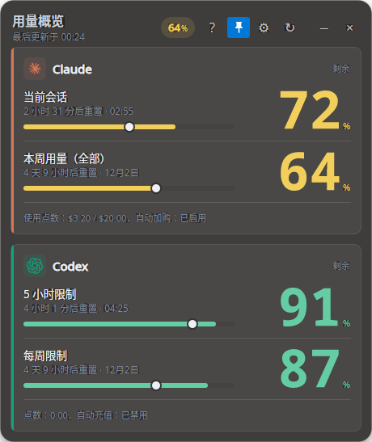
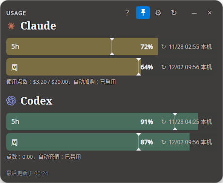
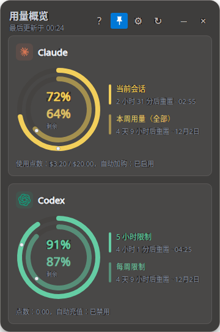

# Claude Codex Usage Companion Linux 版

[](https://github.com/ychsieh95/claude-codex-usage-companion/actions/workflows/ci.yml) [](https://github.com/ychsieh95/claude-codex-usage-companion/releases/latest) [](LICENSE)   [](#snap-软件包)

[English](README.md) · [繁體中文（zh-tw）](README.zh-TW.md)

## 目录

- [简介](#简介)
- [安装](#安装)
  - [系统要求](#系统要求)
  - [下载与安装](#下载与安装)
  - [启动程序](#启动程序)
  - [卸载](#卸载)
- [更多信息](#更多信息)

## 简介

Claude Codex Usage Companion 在 Linux 桌面显示 Claude Code 和 Codex 的用量限制。这是一款在本地运行的开源程序，不含遥测。

此 Linux 版本基于 Windows/WPF 应用 [gkfriend/codex-usage-companion](https://github.com/gkfriend/codex-usage-companion)。

| 最新 | 旧版（v0.1.5） | 圆环 |
| --- | --- | --- |
|  |  |  |

### 功能

| 功能 | 说明 |
| --- | --- |
| [桌面面板](docs/USER-GUIDE.zh-CN.md#桌面面板) | 显示各项用量限制的剩余百分比、重置时间和使用速度。面板保持在其他窗口上方。 |
| [用量提供方](docs/USER-GUIDE.zh-CN.md#用量提供方) | 读取 Claude Code 和 Codex 用量。可分别启用或禁用提供方。 |
| [系统托盘](docs/USER-GUIDE.zh-CN.md#系统托盘) | 关闭面板后，程序仍继续运行。托盘图标可显示剩余百分比。 |
| [通知](docs/USER-GUIDE.zh-CN.md#通知) | 剩余用量偏低或限制重置时，发送桌面通知。 |
| [用量日志](docs/USER-GUIDE.zh-CN.md#用量日志) | 将每次用量更新写入 TXT、CSV 或 JSONL 文件。 |
| [更新](docs/USER-GUIDE.zh-CN.md#更新) | 在 GitHub 检查新版本，并可下载、验证和安装。 |
| [Plasma 6 小部件](docs/USER-GUIDE.zh-CN.md#plasma-6-小部件) | 在 KDE Plasma 面板或桌面显示用量限制。 |
| [CLI](docs/USER-GUIDE.zh-CN.md#cli) | 单次输出用量、以 JSON 输出，或在终端持续显示。 |
| [Codex hooks](docs/USER-GUIDE.zh-CN.md#codex-hooks) | Codex 会话开始或停止时，启动或刷新面板。 |
| [设置](docs/USER-GUIDE.zh-CN.md#设置) | 设置语言、主题、设计、位置、警报、日志、自动启动等选项。 |

程序提供英文、繁体中文和简体中文界面文字。

## 安装

### 系统要求

- Kubuntu 26.04 或其他现代 Linux 发行版。发行软件包适用于 x64。ARM64 请[从源码构建](docs/DEVELOPMENT.zh-CN.md#构建)。
- Wayland 桌面或 X11 会话。
- Codex 用量：已登录且可通过 `codex` 运行的 Codex CLI。
- Claude 用量：已登录的 Claude Code。
- 以下主机库：`libx11-6`、`libice6`、`libsm6`、`libfontconfig1`、`libharfbuzz0b`、`fonts-noto-cjk` 和 `libnotify-bin`。

`.deb` 会自动安装主机库。使用 snap 或便携压缩包时，请运行：

```bash
sudo apt install libx11-6 libice6 libsm6 libfontconfig1 libharfbuzz0b fonts-noto-cjk libnotify-bin
```

发行软件包包含 .NET runtime。

#### 设置 Codex CLI

使用[官方安装程序](https://developers.openai.com/codex/cli)安装或更新 Codex CLI。然后打开新的终端并登录：

```bash
curl -fsSL https://chatgpt.com/codex/install.sh | sh
codex login
```

验证安装结果：

```bash
command -v codex
codex --version
codex login status
codex app-server --help >/dev/null && echo "Codex app-server is available"
```

最后一个命令必须输出 `Codex app-server is available`。

程序也会搜索 `~/.local/bin`、`~/.npm-global/bin` 和 `~/.codex/bin`。如果 Codex 位于其他位置，请设置 `CODEX_CLI_PATH`。

#### 设置 Claude Code（可选）

安装 [Claude Code](https://code.claude.com) 并登录。运行一次 `claude` 以创建 `~/.claude/.credentials.json`。

程序会在 `~/.local/bin`、`~/.npm-global/bin` 和 `~/.claude/local` 搜索 Claude CLI。若不使用 Claude Code，请在设置中取消勾选**启用 Claude 用量显示**。

### 下载与安装

从[最新版本](https://github.com/ychsieh95/claude-codex-usage-companion/releases/latest)下载文件。选择一种程序软件包。Plasma 小部件包和 Codex 插件为可选项。

| 软件包 | 需要 root | 菜单项 | Plasma 小部件 | 适用情况 |
| --- | --- | --- | --- | --- |
| [Debian 软件包](#debian-软件包)（`.deb`） | 是 | 是 | 已包含 | 使用 Debian、Ubuntu 或 Kubuntu。 |
| [Snap 软件包](#snap-软件包)（`.snap`） | 是 | 是 | 单独安装 | 发行版提供 snapd。 |
| [便携压缩包](#便携压缩包)（`.tar.gz`） | 否 | 否 | 单独安装 | 不想安装系统软件包。 |
| [Plasma 小部件包](#plasma-小部件包)（`.plasmoid`） | 否 | — | 仅小部件 | 使用 snap 或便携压缩包。 |
| [Codex 插件](#codex-插件)（`.zip`） | 否 | 否 | 否 | 希望由 Codex 启动并刷新程序。 |

要验证下载的文件，请将 `SHA256SUMS` 放在同一目录，再运行以下命令。每个文件都必须显示 `OK`。

```bash
sha256sum --check --ignore-missing SHA256SUMS
```

#### Debian 软件包

```bash
sudo apt install ./claude-codex-usage-companion_0.2.3_amd64.deb
```

软件包会安装以下内容：

- `claude-codex-usage-companion` 命令和 `claude-codex-usage` 别名。
- 应用菜单项和图标。
- Plasma 6 小部件。

#### Snap 软件包

```bash
sudo snap install --classic --dangerous ./claude-codex-usage-companion_0.2.3_amd64.snap
```

因为文件并非来自 Snap Store，所以需要 `--dangerous` 标志。此 snap 使用 classic 限制模式。程序必须读取并更新 Claude 凭据、读取 `~/.codex`、启动 `codex`、写入自动启动项并调用 `notify-send`。

要添加 `claude-codex-usage` 别名：

```bash
sudo snap alias claude-codex-usage-companion claude-codex-usage
```

要安装附带的 Plasma 小部件：

```bash
kpackagetool6 --type Plasma/Applet --install /snap/claude-codex-usage-companion/current/usr/share/plasma/claude-codex-usage-companion-0.2.3.plasmoid
```

#### 便携压缩包

```bash
tar -xzf claude-codex-usage-companion-0.2.3-linux-x64.tar.gz
cd claude-codex-usage-companion-0.2.3-linux-x64
install -D -m 755 claude-codex-usage-companion ~/.local/bin/claude-codex-usage-companion
```

请确认 `PATH` 包含 `~/.local/bin`。压缩包也包含 Plasma 小部件包，但不会添加菜单项或别名。

自动启动项使用程序文件的路径。移动文件后，请先禁用再启用自动启动。

#### Plasma 小部件包

此软件包仅供 snap 或便携压缩包使用。安装时不需要 root 权限：

```bash
kpackagetool6 --type Plasma/Applet --install ./claude-codex-usage-companion-0.2.3.plasmoid
```

要更新小部件，请将 `--install` 改为 `--upgrade`。

#### Codex 插件

解压 `CodexUsageCompanionMarketplace-v0.2.3-linux-x64.zip`，然后添加市场：

```bash
codex plugin marketplace add /path/to/extracted-marketplace
```

从市场安装并启用插件。Codex 询问时，请检查并信任 `SessionStart` 和 `Stop` hooks。插件包含独立的程序副本，不会添加菜单项、`PATH` 中的命令或 Plasma 小部件。

### 启动程序

从应用菜单启动 **Claude Codex Usage Companion**，或运行：

```bash
claude-codex-usage-companion gui
```

### 卸载

请先在设置中禁用自动启动，再运行对应软件包的命令：

```bash
sudo apt remove claude-codex-usage-companion      # Debian package
sudo snap remove claude-codex-usage-companion     # Snap package
rm ~/.local/bin/claude-codex-usage-companion      # Portable archive
kpackagetool6 --type Plasma/Applet --remove com.github.ychsieh95.claude-codex-usage-companion  # Plasma widget package
```

这些命令会保留设置和日志。要移除，请删除 `${XDG_CONFIG_HOME:-$HOME/.config}/claude-codex-usage-companion` 和 `${XDG_STATE_HOME:-$HOME/.local/state}/claude-codex-usage-companion`。

## 更多信息

- [使用说明](docs/USER-GUIDE.zh-CN.md)
- [开发](docs/DEVELOPMENT.zh-CN.md)
- [变更日志](CHANGELOG.md)
- [隐私](docs/PRIVACY.md)
- [安全](docs/SECURITY.md)
- [参与贡献](docs/CONTRIBUTING.md)
- [MIT 许可证](LICENSE)
