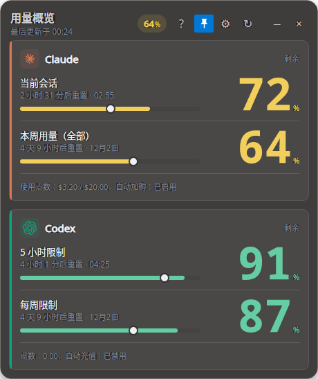
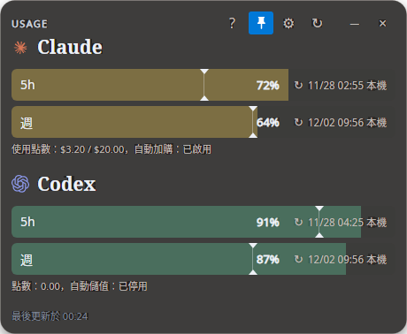
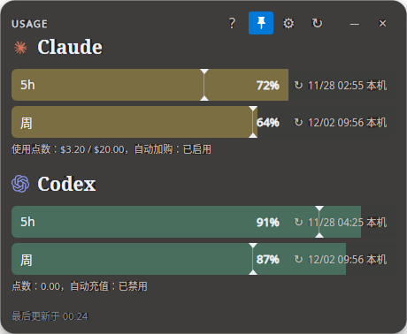
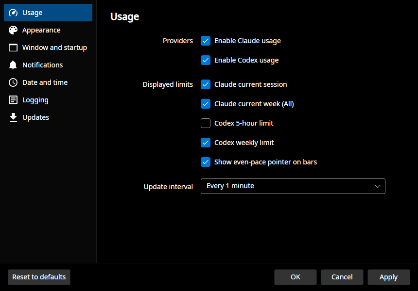
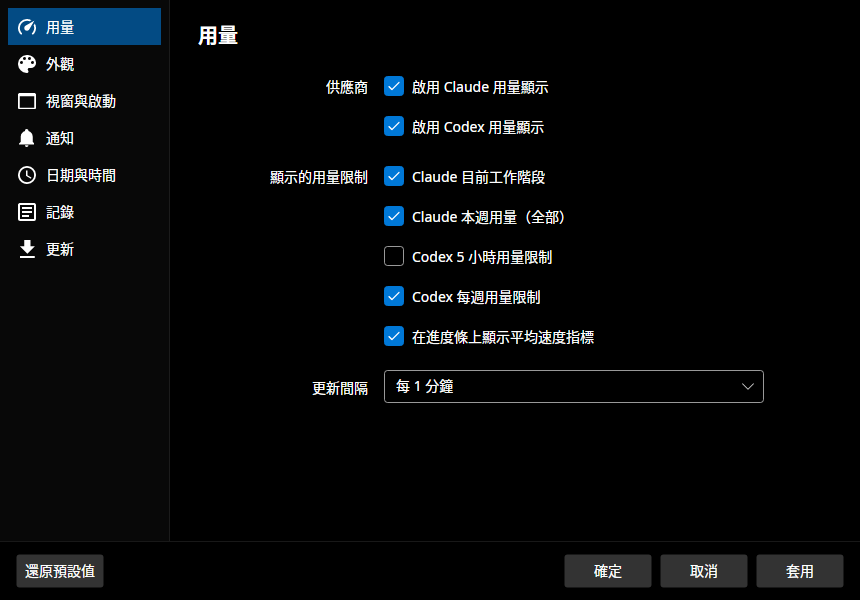

# Claude Codex Usage Companion Linux 版

[](https://github.com/ychsieh95/claude-codex-usage-companion/actions/workflows/ci.yml) [](https://github.com/ychsieh95/claude-codex-usage-companion/releases/latest) [](LICENSE)   [](#snap-套件)

[English](README.md) · [简体中文（zh-cn）](README.zh-CN.md)

Claude Codex Usage Companion 是一套在 Linux 上執行的本機開源 Claude Code 與 Codex 用量監視器，包含：

- 以 Avalonia 建置的小型桌面面板，可保持在其他視窗上方。
- 支援指令碼、單次結果、JSON 輸出與持續更新的 CLI。
- Codex `SessionStart` 與 `Stop` hooks，可啟動或重新整理單一常駐 GUI 程式。
- Claude Code 與 Codex 用量顯示在同一面板。兩者預設皆啟用，可在設定中個別停用。
- 英文、繁體中文與簡體中文用量文字。
- 語言、主題、視窗位置、警示、通知、記錄、圖示、自動啟動與視窗行為設定。
- 四種系統匣圖示樣式：原始圖示、Claude 工作階段剩餘用量、Claude 每週工作階段剩餘用量與 Codex 工作階段剩餘用量。
- 不含遙測。程式會在原始檔案中更新既有 Claude 憑證，且不會將 token 寫入記錄。

此 Linux 移植版以 [gkfriend/codex-usage-companion](https://github.com/gkfriend/codex-usage-companion) 為基礎。原始實作以 Windows/WPF 為目標。

## 面板設計

在**設定 → 外觀**中，選取面板的**設計**：

- **最新**（預設）與 Plasma 小工具的彈出視窗一致。每個供應商各有一張帶有彩色邊緣的卡片。每項限制顯示名稱、重置倒數與本機重置時間、以及細進度條。右側的大字百分比使用等寬字型，與名稱、重置時間及進度條合計等高。點數資訊上方以分隔線與限制隔開。標題列顯示最後更新時間，以及剩餘最少之限制的徽章。將指標移到徽章上可查看是哪一項限制。
- **舊版**還原 v0.1.5 面板，使用帶標籤的 36 像素進度條。

選取**確定**或**套用**以變更設計。

在最新設計中，**限制列**可將每項限制的名稱與重置時間顯示在同一列，讓面板更矮。預設會將重置時間顯示在名稱下方的第二列。

兩種設計都顯示平均速度指標。在最新設計中，指標是進度條上的圓點。將游標移到圓點上可查看使用速度是否比平均速度慢。兩個間距設定與卡片高度調整控點僅適用於舊版設計。

## v0.1.3

面板採用參考 [QuotaGem](https://github.com/gyozalab/QuotaGem) 的供應商標題與圓角進度條。每列顯示 5h／每週標籤、剩餘百分比與本機重置時間，各欄位保持對齊。隱藏供應商時，面板會依內容調整大小，並保留設定的螢幕位置。將游標移至每週進度條可查看點數資訊。

每條進度條都有平均速度指標：上下邊緣的小刻度標出平均使用整個重置週期時，進度條應該停在的位置。若進度條在指標左側結束，代表該用量限制的使用速度比平均快。將游標移至指標可查看此週期已過的比例。面板與展開的 Plasma 小工具在最新設計中改以進度條上的圓點顯示此指標。若要隱藏，請在設定的**用量**區塊取消勾選**在進度條上顯示平均速度指標**，或在小工具設定的 **Popup** 旁取消勾選 **Show even-pace marker**。

設定視窗左側有側邊欄，包含以下頁面：**用量 → 外觀 → 視窗與啟動 → 通知 → 日期與時間 → 記錄 → 更新**。在側邊欄點選頁面即可顯示其設定。每個頁面左側為標籤欄，右側為控制項。**視窗位置**位於**視窗與啟動**頁面。版本與專案連結位於**更新**頁面。

關閉設定時，程式會儲存目前選取的頁面，按下**取消**也會保留。重新開啟設定時（包括重新啟動程式後），會回到此頁面。**取消**會捨棄尚未套用的表單變更。

在**外觀**中設定下列項目：

- 背景顏色：`#RRGGBB` 或 `#AARRGGBB`。留白使用主題顏色。
- 設計：**最新**或**舊版**，預設 **最新**。
- 限制列：將每項限制的名稱與重置時間顯示在同一列，預設關閉。僅適用於**最新**設計。
- 標題徽章：**最新**設計標題列徽章顯示的值。可選**剩餘最少的限制**（預設）、**顯示中限制的平均值**、**Claude（剩餘最少）**、**Codex（剩餘最少）**或**隱藏**。
- 標籤與百分比間距：0–300 像素，預設 **128**。
- 百分比與重置時間間距：0–64 像素，預設 **16**。

外觀變更會立即顯示。按**確定**或**套用**儲存。按**取消**還原已儲存的外觀。既有間距設定會保留。

在**設定 → 更新**中，按**檢查更新**可檢查是否有較新的 GitHub 穩定版本。如有新版本，按**開啟版本頁面**可開啟下載頁面。

**自動檢查更新（啟動時及每天）**預設啟用。程式會在啟動時及執行期間每 24 小時檢查一次。若要停用自動檢查，請取消勾選，再按**確定**或**套用**。仍可手動檢查。

自動檢查發現新版本時會顯示桌面通知。手動檢查的網路錯誤會顯示在設定中。自動檢查的網路錯誤會寫入記錄。

### 自動安裝

檢查發現新版本時，**檢查更新**旁會出現**安裝更新**。若不想每次手動選擇，請勾選**自動下載並安裝更新**，再按**確定**或**套用**。此選項預設關閉，且需要啟用**自動檢查更新**。

實際行為取決於安裝方式。設定會在選項下方顯示目前安裝方式的說明。

| 安裝方式 | 行為 |
| --- | --- |
| 位於可寫入資料夾（例如 `~/.local/bin`）的可攜式封存檔 | 程式下載更新、取代自身檔案並重新啟動，不會要求密碼。 |
| Debian 套件 | 程式在背景下載更新，再以通知詢問是否安裝。按**立即安裝**並輸入管理員密碼後，程式以 `pkexec apt-get install` 安裝套件，然後重新啟動。 |
| Snap | 程式無法取代 snapd 管理的檔案。請開啟版本頁面手動更新。 |
| Codex 外掛程式 | 外掛程式的更新由 Codex 管理。 |

更新套件必須通過兩項檢查才會安裝：

1. 版本中的 `SHA256SUMS` 檔案帶有專案發行金鑰的有效簽章。程式內建公開金鑰，因此遭修改的版本或其他金鑰都無法通過檢查。
2. 下載套件的 SHA-256 雜湊值與已簽署 `SHA256SUMS` 中的項目相符。

v0.2.1 之前的版本沒有簽章，因此程式不會自動安裝。下載檔案存放在 `${XDG_CACHE_HOME:-$HOME/.cache}/claude-codex-usage-companion/updates`，且只保留最新的下載。更新失敗時，通知會附上版本頁面連結，錯誤會寫入記錄。

若要手動檢查下載的版本，請先將[公開金鑰](packaging/update-signing-key.pub.pem)存到下載資料夾，再於該資料夾執行：

```bash
openssl dgst -sha256 -verify update-signing-key.pub.pem -signature SHA256SUMS.sig SHA256SUMS
sha256sum --check --ignore-missing SHA256SUMS
```

隱藏供應商進度條後，用量查詢仍會繼續。取消勾選**啟用 Claude 用量顯示**或**啟用 Codex 用量顯示**，才會停止對應的用量查詢。這也會清除該供應商的錯誤。

已啟用供應商的錯誤會持續顯示，直到該供應商恢復正常。隱藏進度條或其他供應商更新成功都不會清除這些錯誤。完整版本說明請參閱[變更記錄](CHANGELOG.md)。

用量卡片使用 36 像素進度條。每週卡片在進度條下方保留額外空間，顯示點數與自動儲值資訊。卡片會隨較大字體增加高度。調整大小的標記會在游標移上或取得鍵盤焦點時顯示。

程式會將未變更的 78／96 像素預設卡片高度改為較小高度。手動調整過的高度會保留。

程式從首次顯示起就會套用已儲存的間距，包含載入用量時。百分比欄會依文字與間距調整寬度。變更任一間距都會調整面板寬度。手動加寬面板時，多餘空間會放在百分比欄前方。重置時間欄仍靠近右側。預設位置使用桌面工作區域，避免覆蓋保留空間的工作列與面板。

按**還原預設值**可開啟**是／否**確認視窗。按**是**會還原設定表單中的所有偏好，包含卡片高度與間距。按**否**會保留表單不變。按 Escape 或關閉確認視窗也會保留表單不變。

按**確定**或**套用**可儲存還原結果。按**取消**可捨棄還原結果。目前選取的頁面會保留。變更卡片高度時，進度條軌道與填滿區域的高度也會改變。

視窗開啟前會依所有可見卡片與狀態列調整大小。底部僅保留正常內距。首次取得用量結果後，面板會調整原先顯示等待文字的欄位寬度。設定的間距會保留，預設為 128 與 16 像素。

## 螢幕截圖

| 設計 | 英文（`en-US`） | 繁體中文（`zh-tw`） | 簡體中文（`zh-cn`） |
| --- | --- | --- | --- |
| 最新（預設） |  |  |  |
| 舊版（v0.1.5） |  |  |  |

用量面板圖片使用範例資料。可在**設定 → 外觀 → 設計**切換設計。

### 設定

| 英文（`en-US`） | 繁體中文（`zh-tw`） | 簡體中文（`zh-cn`） |
| --- | --- | --- |
|  |  |  |

### 還原確認

**是／否**按鈕文字在按鈕內水平與垂直置中。執行 `bash scripts/capture-screenshots.sh` 可重新產生面板、設定與確認視窗截圖（需要 .NET 10 SDK）。

| 英文（`en-US`） | 繁體中文（`zh-tw`） | 簡體中文（`zh-cn`） |
| --- | --- | --- |
|  |  |  |

### Plasma 6 小工具

| 設計 | 面板 | 展開彈出視窗 |
| --- | --- | --- |
| 最新（預設） |  |  |
| 舊版 |  |  |


## 系統需求

- Kubuntu 26.04 或其他新式 Linux 發行版。發行套件適用於 x64。ARM64 請從原始碼建置，請參閱[建置](#建置)。
- Wayland 桌面環境或 X11 工作階段。
- 已安裝並完成驗證的 Codex CLI，且可透過 `PATH` 中的 `codex` 執行。
- 下列主機程式庫：`libx11-6`、`libice6`、`libsm6`、`libfontconfig1`、`libharfbuzz0b`、`fonts-noto-cjk` 與 `libnotify-bin`。

`.deb` 會自動安裝這些主機程式庫。使用 snap 或可攜式封存檔時，請以下列指令安裝：

```bash
sudo apt install libx11-6 libice6 libsm6 libfontconfig1 libharfbuzz0b fonts-noto-cjk libnotify-bin
```

發行套件為自包含套件，不需要另外安裝 .NET runtime。

## 安裝並驗證 Codex CLI

Claude Codex Usage Companion 需要官方 Codex CLI 及其 `app-server` 子命令。請使用[官方安裝程式](https://developers.openai.com/codex/cli)在 Linux 上安裝或更新至最新版 Codex CLI：

```bash
curl -fsSL https://chatgpt.com/codex/install.sh | sh
```

安裝完成後開啟新的終端機，接著使用 ChatGPT 或其他可用的驗證方式登入：

```bash
codex login
```

驗證執行檔路徑、版本、登入狀態，以及必要的 `app-server` 子命令：

```bash
command -v codex
codex --version
codex login status
codex app-server --help >/dev/null && echo "Codex app-server is available"
```

各命令應依序輸出下列結果：

1. `codex` 的絕對路徑。
2. Codex 版本。
3. 目前的驗證方式。
4. 訊息 `Codex app-server is available`。

如果 `command -v codex` 沒有輸出，請開啟新的終端機。確認 `PATH` 包含安裝程式顯示的安裝目錄。

此程式也會搜尋 `~/.local/bin`、`~/.npm-global/bin` 與 `~/.codex/bin`。如果 Codex 安裝在其他位置，請設定 `CODEX_CLI_PATH=/absolute/path/to/codex`。

## 啟用 Claude 用量（選用）

面板預設顯示 Claude Code 與 Codex 用量。若要使用 Claude 用量，請安裝 [Claude Code](https://code.claude.com)，並登入 Claude Code。執行一次 `claude` 以建立 `~/.claude/.credentials.json`。

若不使用 Claude Code，請在設定中取消勾選**啟用 Claude 用量顯示**。也可在 `settings.json` 設定 `"enableClaudeUsage": false`。**啟用 Codex 用量顯示**核取方塊以同樣方式控制 Codex。

Claude Code 沒有官方用量 API。程式會讀取 Claude Code 儲存在本機的 OAuth access token，並用它呼叫 Anthropic 未公開文件記載的用量端點。

Access token 的有效期只有數小時。Claude CLI 只會在執行時更新它。電腦重新啟動後，儲存的 token 通常已過期。

程式使用 OAuth refresh 授權更新 token，並使用 `~/.claude/.credentials.json` 中的 refresh token。更新後的兩個 token 會以單次不可分割操作寫回該檔案，其餘欄位保持不變。程式使用與 Claude CLI 相同的鎖定檔案，避免同時變更 token。程式不會將 token 寫入記錄。

如果 refresh token 已過期或遭撤銷，程式會顯示錯誤。請執行 `claude` 重新登入。

未公開文件記載的端點可能隨時變更。無論更新間隔設定為何，程式最多每 180 秒查詢一次 Claude 用量。

程式會在 `~/.local/bin`、`~/.npm-global/bin` 與 `~/.claude/local` 搜尋 Claude CLI。如果憑證檔案或 CLI 位於其他位置，請設定對應變數：

- `CLAUDE_CREDENTIALS_PATH=/absolute/path/to/.credentials.json`
- `CLAUDE_CLI_PATH=/absolute/path/to/claude`

## 安裝

從[最新版本](https://github.com/ychsieh95/claude-codex-usage-companion/releases/latest)下載檔案。選擇一種套件安裝方式。Plasma 小工具套件與 Codex plugin 為選用項目。

| 套件 | 需要 root | 選單項目 | Plasma 小工具 | 適用情況 |
| --- | --- | --- | --- | --- |
| [Debian 套件](#debian-套件)（`.deb`） | 是 | 是 | 已包含 | 使用 Debian、Ubuntu 或 Kubuntu。 |
| [Snap 套件](#snap-套件)（`.snap`） | 是 | 是 | 另行安裝 | 發行版提供 snapd。 |
| [可攜式封存檔](#可攜式封存檔)（`.tar.gz`） | 否 | 否 | 另行安裝 | 不想安裝系統套件。 |
| [Plasma 小工具套件](#plasma-小工具套件)（`.plasmoid`） | 否 | — | 僅小工具 | 使用 snap 或可攜式封存檔。 |
| [Codex plugin](#codex-plugin)（`.zip`） | 否 | 否 | 否 | 希望由 Codex 啟動並重新整理程式。 |

若要驗證下載的檔案，請將 `SHA256SUMS` 下載到同一目錄，然後執行：

```bash
sha256sum --check --ignore-missing SHA256SUMS
```

每個下載的檔案都必須顯示 `OK`。

### Debian 套件

使用以下指令安裝套件：

```bash
sudo apt install ./claude-codex-usage-companion_0.2.0_amd64.deb
```

套件會安裝下列項目：

- `claude-codex-usage-companion` 指令與較短的 `claude-codex-usage` 別名。
- 位於 `/usr/share/applications/claude-codex-usage-companion.desktop` 的 KDE/GNOME 應用程式選單項目。
- 位於 `/usr/share/icons/hicolor/scalable/apps/` 的圖示。
- Plasma 6 小工具。

### Snap 套件

使用以下指令安裝套件：

```bash
sudo snap install --classic --dangerous ./claude-codex-usage-companion_0.2.0_amd64.snap
```

由於檔案並非來自 Snap Store，因此需要 `--dangerous` 旗標。

此 snap 使用 classic 隔離模式。程式必須讀取並更新 `~/.claude` 中的 Claude 憑證，也必須讀取 `~/.codex`、啟動 `codex` CLI、寫入自動啟動項目並呼叫 `notify-send`。strict 隔離模式會封鎖這些動作。

此 snap 會在 `/snap/bin` 安裝 `claude-codex-usage-companion` 指令，並新增應用程式選單項目。若要新增較短的 `claude-codex-usage` 別名，請執行：

```bash
sudo snap alias claude-codex-usage-companion claude-codex-usage
```

此 snap 包含 Plasma 小工具套件，但不會自動安裝。若要安裝小工具，請執行：

```bash
kpackagetool6 --type Plasma/Applet --install /snap/claude-codex-usage-companion/current/usr/share/plasma/claude-codex-usage-companion-0.2.0.plasmoid
```

若啟用登入時自動啟動，自動啟動項目會使用 `/snap/bin/claude-codex-usage-companion`。此路徑在 snap 更新後保持不變。

### 可攜式封存檔

解壓縮封存檔，並將程式複製到 `PATH` 中的目錄：

```bash
tar -xzf claude-codex-usage-companion-0.2.0-linux-x64.tar.gz
cd claude-codex-usage-companion-0.2.0-linux-x64
install -D -m 755 claude-codex-usage-companion ~/.local/bin/claude-codex-usage-companion
```

請確認 `PATH` 包含 `~/.local/bin`。Plasma 小工具會從 `PATH` 呼叫程式。

封存檔也包含 Plasma 小工具套件、README 與授權條款。它不會新增選單項目或 `claude-codex-usage` 別名。

自動啟動項目會使用程式檔案的路徑。若移動檔案，請停用後再重新啟用登入時自動啟動。

### Plasma 小工具套件

此套件適用於 snap 或可攜式封存檔。`.deb` 已包含小工具，請勿與 `.deb` 一併使用。可不使用 root 安裝：

```bash
kpackagetool6 --type Plasma/Applet --install ./claude-codex-usage-companion-0.2.0.plasmoid
```

若要更新已安裝的小工具，請以 `--upgrade` 取代 `--install`。小工具需要可從 `PATH` 執行 `claude-codex-usage-companion` 指令。

### Codex plugin

Linux release 建置會產生 `CodexUsageCompanionMarketplace-v0.2.0-linux-x64.zip`。請解壓縮此檔案。使用下列命令加入解壓縮的 marketplace：

```bash
codex plugin marketplace add /path/to/extracted-marketplace
```

從已加入的 marketplace 安裝並啟用 plugin。Codex 詢問時，請檢閱隨附的 `SessionStart` 與 `Stop` hooks。信任 hooks 後才能啟用。Plugin 啟動程式時，程式會使用 `PLUGIN_DATA` 儲存設定。

Plugin 包含自己的程式副本。它不會新增選單項目、`PATH` 中的指令或 Plasma 小工具。

### 解除安裝

請先在設定中停用登入時自動啟動，再依套件執行對應指令：

```bash
sudo apt remove claude-codex-usage-companion      # Debian 套件
sudo snap remove claude-codex-usage-companion     # Snap 套件
rm ~/.local/bin/claude-codex-usage-companion      # 可攜式封存檔
kpackagetool6 --type Plasma/Applet --remove com.github.ychsieh95.claude-codex-usage-companion  # Plasma 小工具套件
```

這些指令會保留設定與記錄。若要移除，請刪除 `${XDG_CONFIG_HOME:-$HOME/.config}/claude-codex-usage-companion` 與 `${XDG_STATE_HOME:-$HOME/.local/state}/claude-codex-usage-companion`。

## 啟動程式

從應用程式選單啟動 **Claude Codex Usage Companion**，或執行：

```bash
claude-codex-usage-companion gui
```

登入時自動啟動預設停用。在設定中啟用後，程式會建立 `${XDG_CONFIG_HOME:-$HOME/.config}/autostart/claude-codex-usage-companion.desktop`。

啟用登入時自動啟動後，會顯示**最小化視窗**選項。否則此選項會隱藏。兩者皆啟用時，程式會在登入時啟動並隱藏視窗。用量仍會在背景更新。

從應用程式選單開啟程式即可顯示視窗。也可使用已啟用的系統匣圖示，或再次執行程式。

按 **⚙ 設定**可設定程式。設定項目包含工作列與系統匣圖示、系統匣圖示樣式及登入時自動啟動。也可設定語言、主題、位置、低用量通知、重置通知、記錄與永遠置頂行為。

- **確定**會儲存變更並關閉設定。
- **取消**會捨棄尚未套用的變更。
- **套用**會儲存變更並保持設定開啟。

在**外觀**中，以 `#RRGGBB` 或 `#AARRGGBB` 設定背景顏色。留白使用主題顏色。百分比與重置時間間距可設為 0–64 像素。5h／每週標籤與百分比間距可設為 0–300 像素。兩者預設分別為 16 與 128 像素。這兩個間距僅適用於**舊版**設計。

面板寬度會自動配合調整。外觀變更會立即顯示。按**取消**可還原上次儲存的外觀。

## Plasma 6 小工具

`.deb` 會安裝 **Claude Codex Usage** Plasma 6 小工具。使用 snap 或可攜式封存檔時，請安裝 [Plasma 小工具套件](#plasma-小工具套件)。加入方式如下：

1. 在 Plasma 桌面或面板按右鍵。
2. 選擇**新增小工具**。
3. 搜尋 `Claude Codex Usage`。
4. 將小工具拖曳到面板或桌面。

小工具顯示四種用量限制：Claude 目前工作階段與本週用量，以及 Codex 5 小時與每週用量。四者預設皆啟用。選取的限制會顯示在面板與展開的彈出視窗中。

在水平面板中，指示器會並排顯示；在垂直面板中則會上下堆疊。開啟小工具可查看本機重置時間、點數、更新狀態與各供應商的錯誤。

設定頁面（英文介面）提供下列選項：

| 選項 | 值 | 效果 |
| --- | --- | --- |
| **Design** | Latest（預設）、Previous | Latest 為目前的外觀，Previous 還原 v0.1.5 的外觀。**Percentages**、**Panel**、**Warn below**、**Critical below**、**Popup badge** 與 **Show credits** 僅適用於最新設計。 |
| **Style** | Radial meters、Meter strips | 面板中顯示圓環或長條。 |
| **Update every** | 1–60 分鐘 | 小工具向程式查詢用量的頻率。 |
| **Percentages** | Remaining（預設）、Used | 顯示各限制的剩餘或已用比例。顏色一律依剩餘量決定，因此紅色代表該限制即將用完。 |
| **On click** | Open the popup（預設）、Open the companion app | 點選面板上的小工具時要執行的動作。 |
| **Panel** | 兩個核取方塊 | 只顯示剩餘最少（或已用最多）的限制而非所有選取的限制，以及顯示或隱藏面板指示器下方的簡短標籤。 |
| **Warn below** 與 **Critical below** | 剩餘 1–100%（預設 70% 與 40%） | 限制低於警告值時顯示琥珀色，低於嚴重值時顯示紅色。 |
| **Reset time** | Countdown and time（預設）、Countdown、Time | 彈出視窗與提示中重置時間的顯示方式。選擇 **Time** 時，超過一天後才重置會加上星期。 |
| **Clock** | System default、12-hour、24-hour | 重置時間與最後更新時間的時鐘格式。 |
| **Tooltip** | 三個核取方塊 | 在面板提示中顯示剩餘最少（或已用最多）的限制、重置時間及最後更新時間。 |
| **Limits** | 四個核取方塊 | 面板與彈出視窗中顯示的限制。 |
| **Popup badge** | Most-used limit（預設）、Average of shown limits、Claude's most-used limit、Codex's most-used limit、Hidden | 彈出視窗標題徽章顯示的值。用量最多的限制即剩餘最少（或已用最多）的限制。平均值涵蓋顯示中的限制。將游標移到徽章上可查看顯示內容。 |
| **Popup** | 兩個核取方塊 | 顯示各供應商下方的點數資訊，以及進度條上的平均速度指標。 |

小工具會呼叫程式的本機 `status --json` 命令。憑證與網路存取由程式處理。

若使用開發 checkout，可執行 `bash scripts/install-plasma-widget.sh` 安裝或更新目前的原始碼套件。Companion CLI 必須維持安裝，並可從 `PATH` 執行。

## CLI

範例使用 `claude-codex-usage` 別名。若沒有此別名，請改用 `claude-codex-usage-companion`。

輸出目前的用量限制：

```bash
claude-codex-usage status
```

回傳機器可讀的 JSON：

```bash
claude-codex-usage status --json
```

每 30 秒持續重新整理終端機：

```bash
claude-codex-usage watch --interval 30
```

輸出設定檔路徑與實際套用的設定：

```bash
claude-codex-usage config
```

`status`、`watch` 及其 `--json` 輸出會先顯示 Claude，再顯示 Codex，與面板卡片順序一致。JSON 結果使用此結構：`{"claude": {"state": ..., "error": ...}, "codex": {"state": ..., "error": ...}}`。停用供應商時，對應鍵值會省略。這會取代先前的扁平 JSON 結構。讀取舊結構的指令碼需要調整。

若 Codex 不在 `PATH` 中，請設定 `CODEX_CLI_PATH=/absolute/path/to/codex`。若要停用 ANSI 色彩，請設定 `NO_COLOR=1` 或傳入 `--no-color`。

## 設定

預設設定檔位於：

```text
${XDG_CONFIG_HOME:-$HOME/.config}/claude-codex-usage-companion/settings.json
```

```json
{
  "showClaudeSession": true,
  "showClaudeWeekly": true,
  "showCodexFiveHour": false,
  "showCodexWeekly": true,
  "enableClaudeUsage": true,
  "enableCodexUsage": true,
  "enableSystemTray": false,
  "trayIconStyle": "original",
  "showTaskbarIcon": true,
  "enableAutoUpdateCheck": true,
  "startOnBoot": false,
  "minimizeOnStart": false,
  "language": "en-US",
  "theme": "system",
  "overlayDesign": "latest",
  "resetTimeOnNameRow": false,
  "headerBadge": "lowest",
  "settingsPage": "usage",
  "backgroundColor": "",
  "percentageTimeSpacing": 16,
  "labelPercentageSpacing": 128,
  "enableLowUsageAlert": false,
  "lowUsageAlertThresholdPercent": 20,
  "notifyOnReset": false,
  "enableUsageLogging": false,
  "usageLogFilePath": "/home/you/.local/state/claude-codex-usage-companion/usage-history.csv",
  "usageLogFormat": "csv",
  "position": "right-bottom",
  "opacity": 1.0,
  "margin": 16,
  "alwaysOnTop": true,
  "refreshIntervalSeconds": 60,
  "resetDateTimeFormat": "MMM D",
  "lastUpdatedDateTimeFormat": "HH:mm"
}
```

語言值為 `en-US`、`zh-tw` 與 `zh-cn`。首次執行時，程式依系統語言選擇：

- `zh-TW`、`zh-HS`、`zh-Hant`、`zh-HK`、`zh-MO` 與其他繁體中文文化特性使用 `zh-tw`。
- `zh-CN`、`zh-Hans`、`zh-SG` 與其他簡體中文文化特性使用 `zh-cn`。
- 其他語言使用 `en-US`。

程式也接受舊版值 `auto` 與 `en`。語言值比對不分大小寫。

主題值：`dark`、`light`、`system`。`system` 是預設值，會跟隨桌面目前的淺色或深色偏好設定。

設計值：`latest` 與 `previous`。`latest` 是預設值。`resetTimeOnNameRow` 會在最新設計中將每項限制的名稱與重置時間顯示在同一列，預設為 `false`。

標題徽章值：`lowest`、`average`、`claude`、`codex`、`hidden`。`lowest` 是預設值。`claude` 與 `codex` 顯示該供應商剩餘最少的限制。`average` 顯示顯示中限制的平均值。

設定頁面值：`usage`、`appearance`、`window`、`notifications`、`dateTime`、`logging`、`updates`。`settingsPage` 儲存設定視窗開啟時顯示的頁面。程式會忽略舊版的 `settingsSections` 值。

系統匣圖示樣式值為 `original`、`claude-current-session`、`claude-weekly-session` 與 `codex-session`。數字樣式會在深色背景上顯示粗體、反鋸齒的七段顯示器數字，且不顯示百分比符號。Codex 工作階段會優先使用 5 小時用量限制，若未提供則改用每週用量。

位置值：`left-top`、`middle-top`、`right-top`、`left-center`、`middle-center`、`right-center`、`left-bottom`、`middle-bottom`、`right-bottom`、`custom`。

選擇位置後會立即顯示。按**確定**或**套用**可保留新位置。按**取消**可還原至上次套用的位置。程式也接受 `top-left` 與 `bottom-right` 等舊版角落位置值。

拖曳標題列可自由移動視窗。程式會將位置改為 `custom` 並儲存座標。在設定中選擇 `custom` 可還原已儲存的位置。若尚未儲存位置，視窗會保留目前位置。

主視窗提供下列快速鍵：

- `F1`：顯示快速鍵清單。
- `S`：開啟設定。
- `Ctrl+R`：重新整理用量。
- `Esc`：關閉視窗。

標題列的 **?** 按鈕與系統匣選單的**鍵盤快速鍵**會開啟相同清單。按 `Esc` 或 `F1` 可關閉清單，也可按**確定**。

在設定中，按 `Ctrl+S` 可儲存變更。按 `Esc` 可關閉設定。若仍有未儲存的變更，程式會在捨棄變更前要求確認。

**更新間隔** 設定提供 1 至 60 分鐘的常用值。目前的 1 分鐘間隔是預設值與最小值。先前儲存在此範圍內的自訂間隔仍可選取。

低用量通知預設停用。啟用後，程式會比較 5 小時及每週剩餘用量與設定的門檻。門檻範圍為 `1`–`100`%。任一剩餘用量低於門檻時，程式會發送一次桌面通知。剩餘用量回升至門檻或以上後，該通知可再次觸發。

重置通知可獨立設定，預設停用。用量更新確認新的重置週期時，程式會發送通知。

重置日期時間預設格式為 `MMM D`（預設）、`MMM D HH:mm`、`yyyy-MM-dd` 與 `yyyy-MM-dd HH:mm`。最後更新預設格式為 `HH:mm`（預設）、`HH:mm:ss`、`MMM D HH:mm` 與 `yyyy-MM-dd HH:mm`。

兩個欄位皆接受自訂 .NET 日期時間格式字串，並支援以大寫 `D` 表示日。輸入時，預覽會使用選取的語言檢查格式。無效格式會顯示錯誤，並停用**確定**與**套用**。月份名稱與日期表示方式會使用選取的語言。

下列設定有範圍限制：

- 不透明度：`0.5`–`1.0`。
- 邊距：`0`–`64` 像素。
- 更新間隔：`60`–`3600` 秒。

`enableClaudeUsage` 與 `enableCodexUsage` 分別控制各供應商，預設皆為 `true`。停用供應商會隱藏其區塊，並停止用量查詢。面板高度會自動調整。

無論更新間隔設定為何，Claude 用量最多每 180 秒查詢一次。請參閱[啟用 Claude 用量（選用）](#啟用-claude-用量選用)。

**顯示的用量限制**核取方塊可控制各張卡片：

- `showClaudeSession`：Claude 目前工作階段。預設顯示。
- `showClaudeWeekly`：Claude 每週用量。預設顯示。
- `showCodexFiveHour`：Codex 5 小時用量。預設隱藏，以保留原有版面。
- `showCodexWeekly`：Codex 每週用量。預設顯示。

## 用量更新記錄

用量記錄預設為停用。啟用後，每次成功的用量更新與更新錯誤都會附加至指定檔案。CSV 是預設格式，預設路徑遵循 `${XDG_STATE_HOME:-$HOME/.local/state}/claude-codex-usage-companion/usage-history.csv`。

程式支援下列記錄格式：

- `txt`：每行一筆鍵值記錄。
- `csv`：標頭後接資料列。
- `jsonl`：每行一個 JSON 物件。

變更格式時，設定的檔名副檔名會自動改為 `.txt`、`.csv` 或 `.jsonl`。相對路徑以程式的 XDG state 目錄為基準。

每筆記錄包含下列欄位：

- 更新時間。
- 供應商：`claude` 或 `codex`。
- 成功或錯誤狀態。
- 5 小時及每週剩餘百分比與重置時間。
- 可用重置點數。
- 任何更新錯誤。

新增的 `provider` 欄位會改變記錄結構。讀取舊記錄檔的剖析程式可能需要調整。

## 建置

安裝 .NET 10 SDK 或更新版本，然後執行：

```bash
bash scripts/build-linux.sh
```

ARM64：

```bash
bash scripts/build-linux.sh linux-arm64
```

重新建置、安裝並啟動已安裝的程式：

```bash
./scripts/rebuild-reinstall.sh
```

指令碼會停止目前執行的程式，並依主機架構建置。接著以 `sudo apt reinstall -f` 重新安裝產生的 `.deb`，再啟動已安裝的程式。任一步驟失敗就會停止。

請以一般桌面使用者執行指令碼。只有安裝套件需要 sudo。

本機重新建置指令碼會停用 NuGet 弱點稽核，避免稽核服務無法連線時出現 `NU1900` 警告。若相依套件尚未快取，下載時仍需要連線至 NuGet。

若要啟用稽核，請執行 `NUGET_AUDIT=true ./scripts/rebuild-reinstall.sh`。直接執行 `build-linux.sh` 與 CI 預設仍啟用稽核。

建置程序會執行測試套件，並在 `artifacts/` 下輸出下列檔案：

- `.deb` 套件。
- 可攜式 `.tar.gz` 封存檔。
- Plasma `.plasmoid` 套件。
- Codex marketplace `.zip` 封存檔。
- 檢查碼。

若也要建置 `.snap` 套件，請以 `sudo snap install snapcraft --classic` 安裝 snapcraft，然後執行：

```bash
bash scripts/build-snap.sh
```

此指令碼會先執行 `build-linux.sh`，再於 `artifacts/` 下寫入 `claude-codex-usage-companion_<version>_<arch>.snap`，並將其加入 `SHA256SUMS`。設定 `SKIP_LINUX_BUILD=true` 可使用既有的建置。設定 `SNAPCRAFT_ARGS=--destructive-mode` 可在沒有 LXD 的 Ubuntu 24.04 主機上建置。

開發環境執行方式：

```bash
dotnet run --project src/CodexUsageCompanion -- status
dotnet run --project src/CodexUsageCompanion -- gui
```

## Linux 行為

GUI 使用 `XDG_RUNTIME_DIR` 下僅限擁有者存取的 Unix socket。此 socket 可確保只執行一個程式實例，並接收重新整理訊號。設定遵循 XDG config 慣例。程式會將有大小限制的記錄檔儲存在 `${XDG_STATE_HOME:-$HOME/.local/state}/claude-codex-usage-companion`。

在提供 XWayland 的 Wayland 桌面中，程式使用 Avalonia 的 X11 相容後端。設定的位置會控制初始視窗位置與後續位置變更。若只有原生 Wayland，合成器會控制位置，並可能忽略此設定。X11 工作階段使用 X11 後端。

拖曳標題列可移動面板。拖曳右下角可調整大小。卡片與進度條會隨寬度調整。視窗較矮時可捲動。

標題列控制項依序為鍵盤快速鍵、釘選、設定、重新整理、最小化與關閉。最小化與關閉控制項之間有較寬的間距。釘選按鈕控制永遠置頂設定。設定與系統匣選單中的**視窗永遠置頂**核取方塊也控制同一設定。

Claude 的**目前工作階段**與**本週用量（全部）**卡片會顯示在 Codex 之前。供應商標題顯示 Claude 或 OpenAI 圖示。每週進度條下方會顯示 Codex 點數餘額與自動儲值資訊。Claude 則顯示加購用量支出與每月上限。提示中也會顯示這些資訊。

系統匣預設停用。停用時，關閉面板會結束程式。啟用時，關閉面板會隱藏視窗，並保留最新用量資料。隱藏期間仍會定時更新，並接收 Codex 用量限制通知。

點選系統匣圖示、選擇**顯示視窗**或再次啟動程式，可還原面板。面板會還原已保留的用量資料與上次螢幕位置，不會立即重新要求用量資料。

系統匣選單包含下列操作，並以分隔線分組：

- **顯示視窗**
- **重新整理使用量**
- **視窗永遠置頂**
- **登入時自動啟動**
- **設定**
- **鍵盤快速鍵**
- **結束**

選擇**結束**可停止程式。

系統匣提示先顯示程式名稱，再以每個用量視窗一行的方式顯示，例如：

- `[Claude] 目前: 剩餘 d% (於 ... 重置)`
- `[Claude] 每週: 剩餘 d% (於 ... 重置)`
- `[Codex] 每週: 剩餘 d% (於 ... 重置)`

最後一行為 `最後更新於 HH:mm`。此行使用選取的最後更新日期時間格式。

拖曳用量卡片底部的小把手可變更高度。程式會自動儲存高度。把手取得鍵盤焦點後，可使用向上／向下鍵調整。

在**設定 → 外觀**中，拖曳**面板字體大小**（80–150%）可查看文字大小。按**套用**或**確定**儲存。游標移上右下角時，會顯示視窗縮放標記。

程式從本機 `codex app-server` 程序讀取 `account/rateLimits/read`。未來 Codex 版本若變更此 API，可能需要更新程式。Claude 用量使用 Anthropic 未公開文件記載的端點，可能隨時變更。請參閱[啟用 Claude 用量（選用）](#啟用-claude-用量選用)。

## 文件寫作規範

英文 README 使用 [ASD-STE100 簡化技術英語](https://www.asd-ste100.org/)作為寫作指南：

- 使用短句與主動語態。
- 每句只提供一項指令。
- 操作步驟中的英文句子最多 20 個單字，說明性英文句子最多 25 個單字。
- 同一事物使用相同術語。
- 保留命令、路徑、設定鍵與介面標籤的原文。

兩個中文版本皆以 `README.md` 為翻譯來源。操作說明、範例與技術細節應與英文版本保持一致。

## 隱私與授權

請參閱 [PRIVACY.md](PRIVACY.md)、[SECURITY.md](SECURITY.md) 與 [MIT License](LICENSE)。
