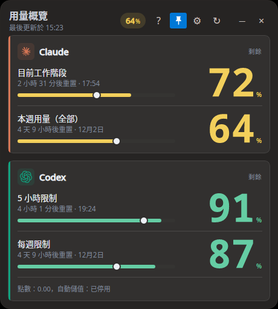
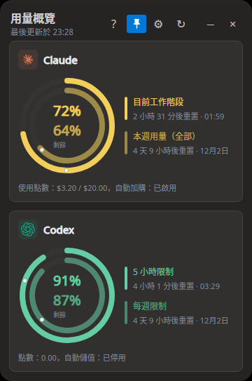

# Claude Codex Usage Companion Linux 版

[](https://github.com/ychsieh95/claude-codex-usage-companion/actions/workflows/ci.yml) [](https://github.com/ychsieh95/claude-codex-usage-companion/releases/latest) [](LICENSE)   [](#snap-套件)

[English](README.md) · [简体中文（zh-cn）](README.zh-CN.md)

## 目錄

- [簡介](#簡介)
- [安裝](#安裝)
  - [系統需求](#系統需求)
  - [下載與安裝](#下載與安裝)
  - [啟動程式](#啟動程式)
  - [解除安裝](#解除安裝)
- [更多資訊](#更多資訊)

## 簡介

Claude Codex Usage Companion 在 Linux 桌面顯示 Claude Code 與 Codex 的用量限制。這是本機執行的開源程式，不含遙測。

此 Linux 版本以 Windows/WPF 應用程式 [gkfriend/codex-usage-companion](https://github.com/gkfriend/codex-usage-companion) 為基礎。

| 最新（進度條） | 最新（圓環） | 舊版 |
| --- | --- | --- |
|  |  |  |

### 功能

| 功能 | 說明 |
| --- | --- |
| [桌面面板](docs/USER-GUIDE.zh-TW.md#桌面面板) | 顯示各項用量限制的剩餘百分比、重置時間與使用速度。面板保持在其他視窗上方。 |
| [用量供應商](docs/USER-GUIDE.zh-TW.md#用量供應商) | 讀取 Claude Code 與 Codex 用量。可個別啟用或停用供應商。 |
| [系統匣](docs/USER-GUIDE.zh-TW.md#系統匣) | 關閉面板後，程式仍繼續執行。系統匣圖示可顯示剩餘百分比。 |
| [通知](docs/USER-GUIDE.zh-TW.md#通知) | 剩餘用量偏低或限制重置時，傳送桌面通知。 |
| [用量記錄](docs/USER-GUIDE.zh-TW.md#用量記錄) | 將每次用量更新寫入 TXT、CSV 或 JSONL 檔案。 |
| [更新](docs/USER-GUIDE.zh-TW.md#更新) | 在 GitHub 檢查新版本，並可下載、驗證及安裝。 |
| [Plasma 6 小工具](docs/USER-GUIDE.zh-TW.md#plasma-6-小工具) | 在 KDE Plasma 面板或桌面顯示用量限制。 |
| [CLI](docs/USER-GUIDE.zh-TW.md#cli) | 單次輸出用量、以 JSON 輸出，或在終端機持續顯示。 |
| [Codex hooks](docs/USER-GUIDE.zh-TW.md#codex-hooks) | Codex 工作階段開始或停止時，啟動或重新整理面板。 |
| [設定](docs/USER-GUIDE.zh-TW.md#設定) | 設定語言、主題、設計、位置、警示、記錄、自動啟動等項目。 |

程式提供英文、繁體中文與簡體中文介面文字。

## 安裝

### 系統需求

- Kubuntu 26.04 或其他新式 Linux 發行版。發行套件適用於 x64。ARM64 請[從原始碼建置](docs/DEVELOPMENT.zh-TW.md#建置)。
- Wayland 桌面或 X11 工作階段。
- Codex 用量：已登入且可透過 `codex` 執行的 Codex CLI。
- Claude 用量：已登入的 Claude Code。
- 下列主機程式庫：`libx11-6`、`libice6`、`libsm6`、`libfontconfig1`、`libharfbuzz0b`、`fonts-noto-cjk` 與 `libnotify-bin`。

`.deb` 會自動安裝主機程式庫。使用 snap 或可攜式封存檔時，請執行：

```bash
sudo apt install libx11-6 libice6 libsm6 libfontconfig1 libharfbuzz0b fonts-noto-cjk libnotify-bin
```

發行套件包含 .NET runtime。

#### 設定 Codex CLI

使用[官方安裝程式](https://developers.openai.com/codex/cli)安裝或更新 Codex CLI。接著開啟新的終端機並登入：

```bash
curl -fsSL https://chatgpt.com/codex/install.sh | sh
codex login
```

驗證安裝結果：

```bash
command -v codex
codex --version
codex login status
codex app-server --help >/dev/null && echo "Codex app-server is available"
```

最後一個命令必須輸出 `Codex app-server is available`。

程式也會搜尋 `~/.local/bin`、`~/.npm-global/bin` 與 `~/.codex/bin`。如果 Codex 位於其他位置，請設定 `CODEX_CLI_PATH`。

#### 設定 Claude Code（選用）

安裝 [Claude Code](https://code.claude.com) 並登入。執行一次 `claude` 以建立 `~/.claude/.credentials.json`。

程式會在 `~/.local/bin`、`~/.npm-global/bin` 與 `~/.claude/local` 搜尋 Claude CLI。若不使用 Claude Code，請在設定中取消勾選**啟用 Claude 用量顯示**。

### 下載與安裝

從[最新版本](https://github.com/ychsieh95/claude-codex-usage-companion/releases/latest)下載檔案。選擇一種程式套件。Plasma 小工具套件與 Codex 外掛程式為選用項目。

| 套件 | 需要 root | 選單項目 | Plasma 小工具 | 適用情況 |
| --- | --- | --- | --- | --- |
| [Debian 套件](#debian-套件)（`.deb`） | 是 | 是 | 已包含 | 使用 Debian、Ubuntu 或 Kubuntu。 |
| [Snap 套件](#snap-套件)（`.snap`） | 是 | 是 | 另行安裝 | 發行版提供 snapd。 |
| [可攜式封存檔](#可攜式封存檔)（`.tar.gz`） | 否 | 否 | 另行安裝 | 不想安裝系統套件。 |
| [Plasma 小工具套件](#plasma-小工具套件)（`.plasmoid`） | 否 | — | 僅小工具 | 使用 snap 或可攜式封存檔。 |
| [Codex 外掛程式](#codex-外掛程式)（`.zip`） | 否 | 否 | 否 | 希望由 Codex 啟動並重新整理程式。 |

若要驗證下載的檔案，請將 `SHA256SUMS` 放在同一目錄，再執行下列命令。每個檔案都必須顯示 `OK`。

```bash
sha256sum --check --ignore-missing SHA256SUMS
```

#### Debian 套件

```bash
sudo apt install ./claude-codex-usage-companion_0.2.3_amd64.deb
```

套件會安裝下列項目：

- `claude-codex-usage-companion` 命令與 `claude-codex-usage` 別名。
- 應用程式選單項目與圖示。
- Plasma 6 小工具。

#### Snap 套件

```bash
sudo snap install --classic --dangerous ./claude-codex-usage-companion_0.2.3_amd64.snap
```

因為檔案並非來自 Snap Store，所以需要 `--dangerous` 旗標。此 snap 使用 classic 隔離模式。程式必須讀取並更新 Claude 憑證、讀取 `~/.codex`、啟動 `codex`、寫入自動啟動項目並呼叫 `notify-send`。

若要新增 `claude-codex-usage` 別名：

```bash
sudo snap alias claude-codex-usage-companion claude-codex-usage
```

若要安裝內附的 Plasma 小工具：

```bash
kpackagetool6 --type Plasma/Applet --install /snap/claude-codex-usage-companion/current/usr/share/plasma/claude-codex-usage-companion-0.2.3.plasmoid
```

#### 可攜式封存檔

```bash
tar -xzf claude-codex-usage-companion-0.2.3-linux-x64.tar.gz
cd claude-codex-usage-companion-0.2.3-linux-x64
install -D -m 755 claude-codex-usage-companion ~/.local/bin/claude-codex-usage-companion
```

請確認 `PATH` 包含 `~/.local/bin`。封存檔也包含 Plasma 小工具套件，但不會新增選單項目或別名。

自動啟動項目使用程式檔案的路徑。移動檔案後，請先停用再啟用自動啟動。

#### Plasma 小工具套件

此套件僅供 snap 或可攜式封存檔使用。安裝時不需要 root 權限：

```bash
kpackagetool6 --type Plasma/Applet --install ./claude-codex-usage-companion-0.2.3.plasmoid
```

若要更新小工具，請將 `--install` 改為 `--upgrade`。

#### Codex 外掛程式

解壓縮 `CodexUsageCompanionMarketplace-v0.2.3-linux-x64.zip`，然後新增市集：

```bash
codex plugin marketplace add /path/to/extracted-marketplace
```

從市集安裝並啟用外掛程式。Codex 詢問時，請檢閱並信任 `SessionStart` 與 `Stop` hooks。外掛程式包含獨立的程式副本，不會新增選單項目、`PATH` 中的命令或 Plasma 小工具。

### 啟動程式

從應用程式選單啟動 **Claude Codex Usage Companion**，或執行：

```bash
claude-codex-usage-companion gui
```

### 解除安裝

請先在設定中停用自動啟動，再執行對應套件的命令：

```bash
sudo apt remove claude-codex-usage-companion      # Debian package
sudo snap remove claude-codex-usage-companion     # Snap package
rm ~/.local/bin/claude-codex-usage-companion      # Portable archive
kpackagetool6 --type Plasma/Applet --remove com.github.ychsieh95.claude-codex-usage-companion  # Plasma widget package
```

這些命令會保留設定與記錄。若要移除，請刪除 `${XDG_CONFIG_HOME:-$HOME/.config}/claude-codex-usage-companion` 與 `${XDG_STATE_HOME:-$HOME/.local/state}/claude-codex-usage-companion`。

## 更多資訊

- [使用說明](docs/USER-GUIDE.zh-TW.md)
- [開發](docs/DEVELOPMENT.zh-TW.md)
- [變更記錄](CHANGELOG.md)
- [隱私權](docs/PRIVACY.md)
- [安全性](docs/SECURITY.md)
- [參與貢獻](docs/CONTRIBUTING.md)
- [MIT 授權條款](LICENSE)
