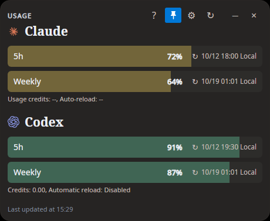
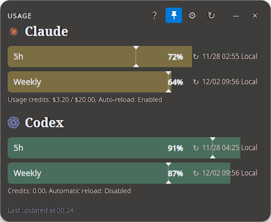
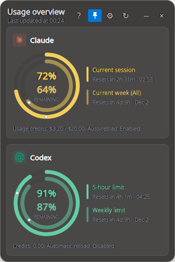
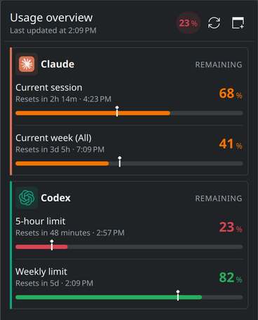
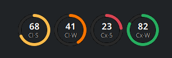

# User guide

[繁體中文（zh-tw）](USER-GUIDE.zh-TW.md) · [简体中文（zh-cn）](USER-GUIDE.zh-CN.md)

This guide explains each function of [Claude Codex Usage Companion](../README.md). For installation, see the [README](../README.md#installation).

## Desktop panel

The panel shows one card for each enabled provider. Claude is first, then Codex. Each card shows the limits that you select:

- Claude: **Current session** and **Current week (All)**.
- Codex: **5-hour** and **Weekly**.

Each limit shows its remaining percentage, a reset countdown, and the local reset time. Below the limits, the panel shows credit details. For Codex, this is the credit balance and automatic reload information. For Claude, this is extra-usage spending and the monthly limit. Tooltips show the same details.

### Designs

Select a design under **Settings → Appearance → Design**.

| Design | Description |
| --- | --- |
| **Latest** (default) | One card for each provider with a colored edge. Each limit has a thin bar and a large monospaced percentage. The heading shows the last update time and a badge. Matches the Plasma widget popup. |
| **Previous** | The v0.1.5 panel, with labelled 36-pixel bars. You can set the column gaps and drag each card to change its height. |
| **Rings** | One circular ring for each provider. The outer ring is the current or 5-hour limit. The inner, lighter ring is the weekly limit. The panel is narrower and has no badge. |

| Latest | Previous (v0.1.5) | Rings |
| --- | --- | --- |
|  |  |  |

In the latest design, **Limit rows** puts each limit's name and reset time on one row. This makes the panel shorter.

### Even-pace pointer

The even-pace pointer marks where the bar would end if you used the limit at an even rate across its reset window. If the bar ends before the pointer, you use the limit faster than an even pace. Move the pointer over the marker to see how much of the window has passed.

- Latest design: a dot on the bar.
- Rings design: a dot on the ring.
- Previous design: small ticks on the top and bottom edges of the bar.

To hide it, clear **Show even-pace pointer on bars** on the **Usage** page of Settings.

### Header badge

In the latest design, the heading has a badge with one value. Move the pointer over the badge to see what it shows. Click the badge to open a menu and change the value. The app saves the change.

| Badge value | Shows |
| --- | --- |
| **Lowest remaining limit** (default) | The lowest remaining percentage of all shown limits. |
| **Average of shown limits** | The average of all shown limits. |
| **Claude (lowest remaining)**, **Codex (lowest remaining)** | The lowest remaining limit of one provider. |
| **Claude: current session**, **Claude: weekly**, **Codex: 5-hour**, **Codex: weekly** | One limit, also when its row is hidden. |
| **Claude: average**, **Codex: average** | The average of one provider's shown limits. |
| **Hidden** | No badge. The app asks before it hides the badge. To show it again, use **Settings → Appearance → Header badge**. |

**Badge average** sets how the average values combine the limits:

- **Plain average** (default): each limit counts the same.
- **Weighted by time to reset**: a limit that refills soon counts less.
- **Weighted by window length**: weekly limits count more than 5-hour limits.
- **Gap from even pace**: the remaining percentage minus the share of the window still to come, as signed points. A value above 0 means that you use less than an even pace.

### Window controls

The header controls are, in order: keyboard shortcuts, pin, settings, refresh, minimize, and close. The pin button turns **Keep window always on top** on or off.

- Drag the header to move the panel. The app saves the location as the `custom` position.
- Drag the lower-right corner to resize the panel.
- In the previous design, drag the handle at the bottom of a card to change its height. When the handle has keyboard focus, use the Up and Down keys.

Keyboard shortcuts in the main window:

| Key | Action |
| --- | --- |
| `F1` | Show the shortcut list. |
| `S` | Open Settings. |
| `Ctrl+R` | Refresh usage. |
| `Esc` | Close the window. |

## Usage providers

Both providers are enabled by default. To stop the usage checks of a provider, clear **Enable Claude usage** or **Enable Codex usage** on the **Usage** page of Settings. This also hides the provider's card and clears its errors.

To hide one limit but keep its checks, clear its checkbox under **Displayed limits**. Codex **5-hour** is hidden by default.

An error stays visible until its provider recovers. Hidden limits and updates from the other provider do not clear it.

### Codex

The app starts a local `codex app-server` process and reads `account/rateLimits/read`. It needs the Codex CLI. See [Set up Codex CLI](../README.md#set-up-codex-cli).

### Claude Code

Claude Code has no official usage API. The app reads the OAuth access token that Claude Code stores in `~/.claude/.credentials.json`. It uses the token to call an undocumented Anthropic usage endpoint. This endpoint can change without notice.

- The app checks Claude usage at most once every 180 seconds, at all update intervals.
- When the access token expires, the app renews it with the refresh token in the same file. It writes both new tokens in one atomic operation and keeps all other fields.
- The app uses the same lock file as Claude CLI, so the two do not change the tokens at the same time.
- The app never writes tokens to logs.

If the refresh token has expired or is revoked, the app shows an error. Run `claude` to sign in again. See [Set up Claude Code](../README.md#set-up-claude-code-optional).

## System tray

The system tray is disabled by default. To enable it, use the **System tray** option on the **Window and startup** page of Settings.

- When the tray is disabled, closing the panel stops the app.
- When the tray is enabled, closing the panel hides it. Scheduled updates and notifications continue.

To show the panel again, select the tray icon or **Show window**, or start the app again. The panel shows the saved usage data at its last position.

**Tray icon style** sets the icon:

| Style | Icon |
| --- | --- |
| `original` (default) | The app icon. |
| `claude-current-session` | Claude current session remaining percentage. |
| `claude-weekly-session` | Claude weekly remaining percentage. |
| `codex-session` | Codex 5-hour remaining percentage. If that limit is not available, Codex weekly. |

Numeric styles show bold seven-segment digits on a dark background, without a percent sign.

The tray menu has these items:

- **Show window**
- **Refresh usage**
- **Keep window always on top**
- **Start automatically when I sign in**
- **Check for updates**
- **Check for updates automatically**
- **Settings**
- **Keyboard shortcuts**
- **Quit**

The tray tooltip shows one line for each limit and the last update time, for example:

```text
Claude Codex Usage Companion
[Claude] Current: 62% remaining (Resets at ...)
[Claude] Weekly: 80% remaining (Resets at ...)
[Codex] Weekly: 45% remaining (Resets at ...)
Last updated at 14:05
```

## Notifications

Set notifications on the **Notifications** page of Settings. Both types are disabled by default.

- **Low-usage alert**: the app sends one notification when the remaining 5-hour or weekly usage falls below the threshold. The threshold is 1–100 percent. The default is 20. The alert is available again after the limit returns to the threshold or higher.
- **Reset notification**: the app sends a notification when a usage update confirms a new reset window.

Notifications use `notify-send`. Update checks also send notifications. See [Updates](#updates).

## Usage logging

Usage logging is disabled by default. When you enable it on the **Logging** page of Settings, the app adds each successful update and each update error to a file.

The default file is `${XDG_STATE_HOME:-$HOME/.local/state}/claude-codex-usage-companion/usage-history.csv`. A relative path starts at the app's XDG state directory.

| Format | Content |
| --- | --- |
| `txt` | One key/value record on each line. |
| `csv` (default) | A header row, then one data row for each record. |
| `jsonl` | One JSON object on each line. |

When you change the format, the app changes the file extension to match.

Each record has these fields:

- Update timestamp.
- Provider: `claude` or `codex`.
- Success or error status.
- 5-hour and weekly remaining percentages and reset times.
- Available reset credits.
- The update error, if there is one.

## Updates

The app checks for a newer stable GitHub release. Use the **Updates** page of Settings or the tray menu.

- **Automatically check for updates (startup and daily)** is enabled by default. The app checks at startup and every 24 hours.
- **Check for updates** checks immediately, also when automatic checks are off.
- When a newer version is available, Settings shows **Install update** and **Open release page**. The tray check shows a notification. If the app can install the update, the notification has an **Install now** button.
- **Automatically download and install updates** installs new versions without a prompt where possible. It is off by default and requires automatic checks.

Nothing is downloaded until you select **Install now** or **Install update**, or enable automatic installation.

### Progress

While an update downloads and installs, the app shows each stage: signature check, download, package check, and installation. The download shows the megabytes received and a percentage.

- In Settings, a progress bar and a status line appear below the buttons.
- For installs from a notification or from automatic installation, one desktop notification shows the progress. When the install is complete, the same notification shows the result.

### Reinstall

You can install the current release again, for example to repair the installation.

On the **Updates** page of Settings, select **Reinstall latest version**. The app checks for the latest release and installs it. If a newer version is available, the app installs that version.

The button appears only when your installation can install packages. See [Install behavior](#install-behavior). Reinstall uses the same verification as an update. If the release has no package for your installation, Settings shows **Open release page**.

### Install behavior

The behavior depends on how you installed the app. Settings shows a note for your installation.

| Installation | Behavior |
| --- | --- |
| Portable archive in a folder that you can write to, such as `~/.local/bin` | The app downloads the update, replaces its file, and restarts. It does not ask for a password. |
| Debian package | The app downloads the update in the background. A notification asks you to install it. Select **Install now** and enter your administrator password. The app runs `pkexec apt-get install` and restarts. |
| Snap | The app cannot replace files that snapd owns. Open the release page to update manually. |
| Codex plugin | Codex manages plugin updates. |

### Verification

The app installs an update only when the package passes two checks:

1. The `SHA256SUMS` file has a valid signature from the project's release key. The app contains the public key.
2. The SHA-256 hash of the package matches its entry in the signed `SHA256SUMS`.

Releases before v0.2.1 have no signature, so the app does not install them automatically.

Downloads go to `${XDG_CACHE_HOME:-$HOME/.cache}/claude-codex-usage-companion/updates`. The app keeps only the latest download. If an update fails, a notification links to the release page, and the app writes the error to its log.

To verify a release manually, save the [public key](../packaging/update-signing-key.pub.pem) in the download folder. Then run:

```bash
openssl dgst -sha256 -verify update-signing-key.pub.pem -signature SHA256SUMS.sig SHA256SUMS
sha256sum --check --ignore-missing SHA256SUMS
```

## Plasma 6 widget

The **Claude Codex Usage** widget shows the four limits in a Plasma panel or on the desktop. Select the widget to open a popup with reset times, credits, update status, and errors.

| Design | Panel | Expanded popup |
| --- | --- | --- |
| Latest (default) |  |  |
| Previous |  |  |

To add the widget:

1. Right-click the Plasma desktop or panel.
2. Select **Add Widgets**.
3. Search for `Claude Codex Usage`.
4. Drag the widget onto the panel or desktop.

The `.deb` includes the widget. For the snap or the portable archive, install the [Plasma widget package](../README.md#plasma-widget-package).

The widget calls the app's `status --json` command. The app must be available on `PATH`. The app reads the credentials and does all network access.


The configuration page has these options:

| Option | Values | Effect |
| --- | --- | --- |
| **Design** | Latest (default), Previous | The widget look. **Percentages**, **Panel**, **Warn below**, **Critical below**, **Popup badge**, and **Show credits** apply only to the latest design. |
| **Style** | Radial meters, Meter strips | Circles or bars in the panel. |
| **Update every** | 1–60 minutes | How often the widget asks the app for usage. |
| **Percentages** | Remaining (default), Used | Shows how much of each limit is left or used. Colors always follow the remaining amount. |
| **On click** | Open the popup (default), Open the companion app | What a click on the panel widget does. |
| **Panel** | Two checkboxes | Show only the lowest remaining (or highest used) limit. Show or hide the short labels. |
| **Warn below** and **Critical below** | 1–100% left (defaults 70% and 40%) | A limit is amber below the warning level and red below the critical level. |
| **Reset time** | Countdown and time (default), Countdown, Time | How reset times appear. With **Time**, resets more than one day away include the weekday. |
| **Clock** | System default, 12-hour, 24-hour | The clock format for reset times and the last update time. |
| **Tooltip** | Three checkboxes | Show the lowest remaining (or highest used) limit, reset times, and the last update time. |
| **Limits** | Four checkboxes | The limits in the panel and popup. |
| **Popup badge** | Most-used limit (default), Average of shown limits, Claude's most-used limit, Codex's most-used limit, Hidden | The value in the popup header badge. |
| **Popup** | Two checkboxes | Show the credits line and the even-pace marker. |

In a horizontal panel, the indicators are side by side. In a vertical panel, they are stacked.

## CLI

The examples use the `claude-codex-usage` alias. If you do not have the alias, use `claude-codex-usage-companion`.

| Command | Action |
| --- | --- |
| `claude-codex-usage gui` | Start the desktop panel, or show it if it already runs. |
| `claude-codex-usage status` | Print the current limits. |
| `claude-codex-usage status --json` | Print the current limits as JSON. |
| `claude-codex-usage watch --interval 30` | Refresh the terminal every 30 seconds. |
| `claude-codex-usage config` | Print the settings path and the effective settings. |

The output shows Claude before Codex. The JSON output has this structure:

```json
{"claude": {"state": ..., "error": ...}, "codex": {"state": ..., "error": ...}}
```

If a provider is disabled, its key is absent.

To disable ANSI colors, set `NO_COLOR=1` or use `--no-color`.

## Codex hooks

The [Codex plugin](../README.md#codex-plugin) adds two Codex hooks:

- `SessionStart`: runs when a Codex session starts or resumes.
- `Stop`: runs when Codex finishes a turn.

Each hook tells the running panel to refresh usage. If the panel does not run, the hook starts it.

Only one panel process runs at a time. When the plugin starts the app, the app keeps its settings in `PLUGIN_DATA`.

## Settings

Select **⚙ Settings** in the panel header or the tray menu. Settings has these pages:

| Page | Settings |
| --- | --- |
| **Usage** | Enable each provider, displayed limits, even-pace pointer, update interval (1–60 minutes, default 1). |
| **Appearance** | Language, theme, design, limit rows, header badge, badge average, panel font size (80–150%), background color, column gaps (previous design only). |
| **Window and startup** | Window position, always on top, taskbar icon, system tray and tray icon style, start at sign-in, minimize at startup. |
| **Notifications** | Low-usage alert, reset notification, alert threshold. |
| **Date and time** | Reset date/time format, last-updated date/time format. |
| **Logging** | Usage logging, log file path, log format. |
| **Updates** | Automatic checks, automatic installation, check, install, and reinstall buttons, update progress, version, and project links. |

- **OK** saves the changes and closes Settings.
- **Apply** saves the changes and keeps Settings open.
- **Cancel** discards the changes that you did not apply.
- **Reset to defaults** asks for confirmation, then restores all values in the form. Select **OK** or **Apply** to save them.
- `Ctrl+S` saves. `Esc` closes Settings. If there are unsaved changes, the app asks before it discards them.

Appearance and position changes appear immediately. **Cancel** restores the saved values. Settings opens on the page that you used last.

### Option details

- **Theme**: `system` (default) follows the desktop light or dark preference. You can also select `dark` or `light`.
- **Language**: on the first run, the app selects the language from the system culture. Traditional Chinese cultures use `zh-tw`. Simplified Chinese cultures use `zh-cn`. All other cultures use `en-US`.
- **Background color**: `#RRGGBB` or `#AARRGGBB`. An empty field uses the theme color.
- **Window position**: nine preset positions or `custom`. Presets use the desktop working area, so the panel does not cover reserved taskbars.
- **Start at sign-in**: creates `${XDG_CONFIG_HOME:-$HOME/.config}/autostart/claude-codex-usage-companion.desktop`. When it is on, **Minimize the window** starts the app with the panel hidden.
- **Date and time formats**: select a preset or type a .NET date/time format string. Uppercase `D` is the day token. A preview checks the format as you type. An invalid format disables **OK** and **Apply**.

| Format | Presets |
| --- | --- |
| Reset date/time | `MMM D` (default), `MMM D HH:mm`, `yyyy-MM-dd`, `yyyy-MM-dd HH:mm` |
| Last updated | `HH:mm` (default), `HH:mm:ss`, `MMM D HH:mm`, `yyyy-MM-dd HH:mm` |

### Settings file

The default settings file is:

```text
${XDG_CONFIG_HOME:-$HOME/.config}/claude-codex-usage-companion/settings.json
```

```json
{
  "showClaudeSession": true,
  "showClaudeWeekly": true,
  "showCodexFiveHour": false,
  "showCodexWeekly": true,
  "enableClaudeUsage": true,
  "enableCodexUsage": true,
  "enableSystemTray": false,
  "trayIconStyle": "original",
  "showTaskbarIcon": true,
  "enableAutoUpdateCheck": true,
  "startOnBoot": false,
  "minimizeOnStart": false,
  "language": "en-US",
  "theme": "system",
  "overlayDesign": "latest",
  "resetTimeOnNameRow": false,
  "headerBadge": "lowest",
  "confirmHideBadge": true,
  "badgeAverage": "plain",
  "settingsPage": "usage",
  "backgroundColor": "",
  "percentageTimeSpacing": 16,
  "labelPercentageSpacing": 128,
  "enableLowUsageAlert": false,
  "lowUsageAlertThresholdPercent": 20,
  "notifyOnReset": false,
  "enableUsageLogging": false,
  "usageLogFilePath": "/home/you/.local/state/claude-codex-usage-companion/usage-history.csv",
  "usageLogFormat": "csv",
  "position": "right-bottom",
  "opacity": 1.0,
  "margin": 16,
  "alwaysOnTop": true,
  "refreshIntervalSeconds": 60,
  "resetDateTimeFormat": "MMM D",
  "lastUpdatedDateTimeFormat": "HH:mm"
}
```

| Key | Values |
| --- | --- |
| `language` | `en-US`, `zh-tw`, `zh-cn`. The legacy values `auto` and `en` are also accepted. |
| `theme` | `system`, `dark`, `light` |
| `overlayDesign` | `latest`, `previous`, `rings` |
| `headerBadge` | `lowest`, `average`, `claude`, `claude-session`, `claude-weekly`, `claude-average`, `codex`, `codex-five-hour`, `codex-weekly`, `codex-average`, `hidden` |
| `badgeAverage` | `plain`, `time-to-reset`, `window-length`, `pace` |
| `trayIconStyle` | `original`, `claude-current-session`, `claude-weekly-session`, `codex-session` |
| `position` | `left-top`, `middle-top`, `right-top`, `left-center`, `middle-center`, `right-center`, `left-bottom`, `middle-bottom`, `right-bottom`, `custom`. Legacy values such as `top-left` are also accepted. |
| `settingsPage` | `usage`, `appearance`, `window`, `notifications`, `dateTime`, `logging`, `updates` |
| `usageLogFormat` | `txt`, `csv`, `jsonl` |
| `opacity` | `0.5`–`1.0` |
| `margin` | `0`–`64` pixels |
| `refreshIntervalSeconds` | `60`–`3600` |
| `labelPercentageSpacing` | `0`–`300` pixels (previous design) |
| `percentageTimeSpacing` | `0`–`64` pixels (previous design) |

### Environment variables

| Variable | Use |
| --- | --- |
| `CODEX_CLI_PATH` | Absolute path to `codex`, if it is not on `PATH`. |
| `CLAUDE_CLI_PATH` | Absolute path to `claude`, if it is not on `PATH`. |
| `CLAUDE_CREDENTIALS_PATH` | Absolute path to the Claude `.credentials.json` file. |
| `NO_COLOR` | Disables ANSI colors in the CLI. |
