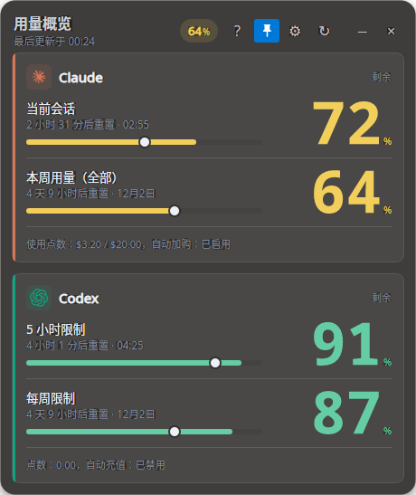
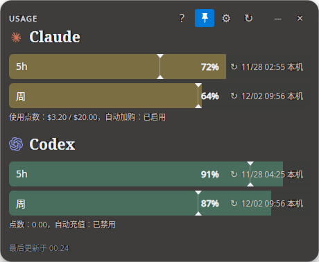
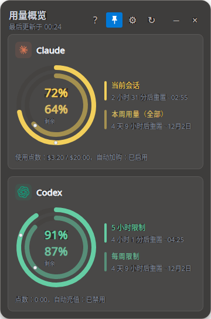
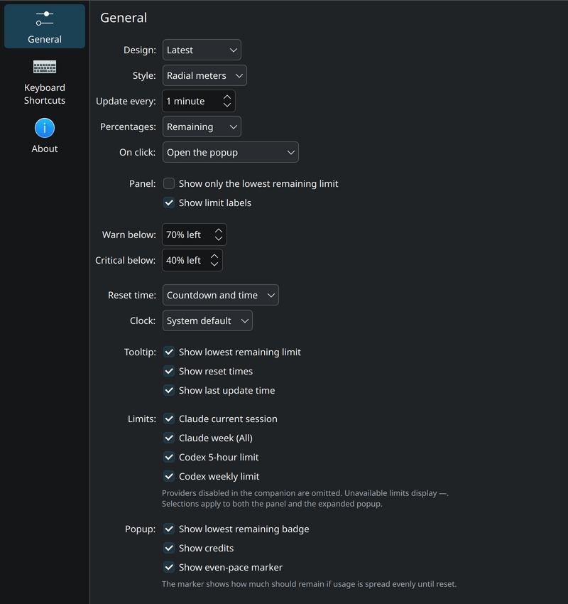

# 使用说明

[English](USER-GUIDE.md) · [繁體中文（zh-tw）](USER-GUIDE.zh-TW.md)

本文档说明 [Claude Codex Usage Companion](../README.zh-CN.md) 的各项功能。安装方式请参阅 [README](../README.zh-CN.md#安装)。

## 桌面面板

面板为每个已启用的提供方显示一张卡片，Claude 在前，Codex 在后。各卡片显示您选择的限制：

- Claude：**当前会话**和**本周用量（全部）**。
- Codex：**5 小时用量限制**和**每周用量限制**。

每项限制显示剩余百分比、重置倒计时和本地重置时间。限制下方显示点数信息：Codex 显示点数余额和自动充值信息；Claude 显示额外用量支出和每月上限。工具提示也会显示相同信息。

### 设计

在**设置 → 外观 → 设计**中选择设计。

| 设计 | 说明 |
| --- | --- |
| **最新**（默认） | 每个提供方各有一张带彩色边缘的卡片。每项限制显示细进度条和等宽字体的大号百分比。标题栏显示最后更新时间和徽章，与 Plasma 小部件的弹出窗口一致。 |
| **旧版（v0.1.5）** | v0.1.5 面板，使用带标签的 36 像素进度条。可设置列间距，并拖动各卡片调整高度。 |
| **圆环** | 每个提供方以一组圆环显示。外环为当前或 5 小时限制，颜色较浅的内环为每周限制。面板较窄，且不显示徽章。 |

| 最新 | 旧版（v0.1.5） | 圆环 |
| --- | --- | --- |
|  |  |  |

在最新设计中，**限制行**会将每项限制的名称和重置时间放在同一行，让面板更矮。

### 平均速度指针

平均速度指针标出在整个重置周期内均匀使用额度时，进度条应该停在的位置。若进度条在指针之前结束，表示使用速度比平均快。将鼠标指针移至标记可查看此周期已过的比例。

- 最新设计：进度条上的圆点。
- 圆环设计：圆环上的圆点。
- 旧版设计：进度条上下边缘的小刻度。

要隐藏它，请在设置的**用量**页面取消勾选**在进度条上显示平均速度指针**。

### 标题徽章

最新设计的标题栏有一个显示单一数值的徽章。将鼠标指针移至徽章可查看其显示内容。单击徽章可打开菜单并更改数值，程序会保存更改。

| 徽章值 | 显示内容 |
| --- | --- |
| **剩余最少的限制**（默认） | 所有显示中限制的最低剩余百分比。 |
| **显示中限制的平均值** | 所有显示中限制的平均值。 |
| **Claude（剩余最少）**、**Codex（剩余最少）** | 单个提供方剩余最少的限制。 |
| **Claude：当前会话**、**Claude：每周**、**Codex：5 小时**、**Codex：每周** | 单项限制，即使该行已隐藏也会显示。 |
| **Claude：平均值**、**Codex：平均值** | 单个提供方显示中限制的平均值。 |
| **隐藏** | 不显示徽章。隐藏前程序会要求确认。要再次显示，请使用**设置 → 外观 → 标题徽章**。 |

**徽章平均方式**设置平均值如何合并各项限制：

- **简单平均**（默认）：各项限制的权重相同。
- **按距离重置时间加权**：即将重置的限制权重较低。
- **按时间窗长度加权**：每周限制比 5 小时限制权重更高。
- **与平均速度的差距**：剩余百分比减去时间窗尚未经过的比例，以带正负号的百分点表示。大于 0 表示使用速度比平均慢。

### 窗口控制

标题栏的控件依次为键盘快捷键、固定、设置、刷新、最小化和关闭。固定按钮可开启或关闭**窗口始终置顶**。

- 拖动标题栏移动面板。程序会将位置保存为 `custom`。
- 拖动右下角调整面板大小。
- 在旧版设计中，拖动卡片底部的手柄调整高度。手柄获得键盘焦点时，可使用向上和向下键。

主窗口的键盘快捷键：

| 按键 | 操作 |
| --- | --- |
| `F1` | 显示快捷键列表。 |
| `S` | 打开设置。 |
| `Ctrl+R` | 刷新用量。 |
| `Esc` | 关闭窗口。 |

## 用量提供方

两个提供方默认均启用。要停止查询某个提供方的用量，请在设置的**用量**页面取消勾选**启用 Claude 用量显示**或**启用 Codex 用量显示**。这也会隐藏该提供方的卡片并清除其错误。

要隐藏单项限制但继续查询，请在**显示的用量限制**下取消勾选该项。Codex **5 小时用量限制**默认隐藏。

错误会持续显示，直到该提供方恢复正常。隐藏限制或另一个提供方更新都不会清除错误。

### Codex

程序会启动本地 `codex app-server` 进程，并读取 `account/rateLimits/read`。这需要 Codex CLI，请参阅[设置 Codex CLI](../README.zh-CN.md#设置-codex-cli)。

### Claude Code

Claude Code 没有官方用量 API。程序会读取 Claude Code 保存在 `~/.claude/.credentials.json` 中的 OAuth access token，并用它调用 Anthropic 未公开文档的用量端点。此端点可能随时变更，恕不另行通知。

- 无论更新间隔如何，程序最多每 180 秒查询一次 Claude 用量。
- Access token 过期时，程序会使用同一文件中的 refresh token 更新它。两个新 token 会通过一次原子操作写入，其余字段保持不变。
- 程序使用与 Claude CLI 相同的锁文件，避免两者同时更改 token。
- 程序绝不将 token 写入日志。

如果 refresh token 已过期或被撤销，程序会显示错误。请运行 `claude` 重新登录。请参阅[设置 Claude Code（可选）](../README.zh-CN.md#设置-claude-code可选)。

## 系统托盘

系统托盘默认禁用。要启用，请使用设置中**窗口与启动**页面的**系统托盘**选项。

- 托盘禁用时，关闭面板会停止程序。
- 托盘启用时，关闭面板只会隐藏它。定时更新和通知会继续运行。

要再次显示面板，请选择托盘图标或**显示窗口**，或再次启动程序。面板会在上次的位置显示已保存的用量数据。

**系统托盘图标样式**设置图标：

| 样式 | 图标 |
| --- | --- |
| `original`（默认） | 程序图标。 |
| `claude-current-session` | Claude 当前会话的剩余百分比。 |
| `claude-weekly-session` | Claude 每周剩余百分比。 |
| `codex-session` | Codex 5 小时剩余百分比。若无此限制，则显示 Codex 每周剩余百分比。 |

数字样式在深色背景上显示粗体七段数字，不含百分号。

托盘菜单有以下选项：

- **显示窗口**
- **刷新用量**
- **窗口始终置顶**
- **登录时自动启动**
- **检查更新**
- **自动检查更新**
- **设置**
- **键盘快捷键**
- **退出**

托盘工具提示以每行一项限制的方式显示用量和最后更新时间，例如：

```text
Claude Codex Usage Companion
[Claude] Current: 62% remaining (Resets at ...)
[Claude] Weekly: 80% remaining (Resets at ...)
[Codex] Weekly: 45% remaining (Resets at ...)
Last updated at 14:05
```

## 通知

在设置的**通知**页面设置通知。两种类型默认均禁用。

- **剩余用量低于阈值时发出通知**：5 小时或每周剩余用量低于阈值时，程序发送一次通知。阈值范围为 1–100%，默认为 20。用量回到阈值或以上后，可再次触发警报。
- **用量重置时发出通知**：用量更新确认新的重置周期时，程序会发送通知。

通知使用 `notify-send`。更新检查也会发送通知，请参阅[更新](#更新)。

## 用量日志

用量日志默认禁用。在设置的**日志**页面启用后，程序会将每次成功更新和更新错误追加到文件。

默认文件为 `${XDG_STATE_HOME:-$HOME/.local/state}/claude-codex-usage-companion/usage-history.csv`。相对路径以程序的 XDG 状态目录为起点。

| 格式 | 内容 |
| --- | --- |
| `txt` | 每行一条键值记录。 |
| `csv`（默认） | 一行表头，之后每条记录各占一行。 |
| `jsonl` | 每行一个 JSON 对象。 |

更改格式时，程序会相应更改文件扩展名。

每条记录包含以下字段：

- 更新时间戳。
- 提供方：`claude` 或 `codex`。
- 成功或错误状态。
- 5 小时和每周剩余百分比及重置时间。
- 可用的重置点数。
- 更新错误（如有）。

## 更新

程序会在 GitHub 检查更新的稳定版本。请使用设置的**更新**页面或托盘菜单。

- **自动检查更新（启动时及每天）**默认启用。程序在启动时及每 24 小时检查一次。
- **检查更新**会立即检查，即使已关闭自动检查。
- 有新版本时，设置会显示**安装更新**和**打开版本页面**。从托盘检查会显示通知。若程序可安装更新，通知会有**立即安装**按钮。
- **自动下载并安装更新**会在可行时直接安装新版本，不再询问。此选项默认关闭，且需要启用自动检查。

在您选择**立即安装**或**安装更新**，或启用自动安装之前，程序不会下载任何文件。

### 进度

下载和安装更新时，程序会显示各阶段：签名检查、下载、软件包检查和安装。下载时会显示已接收的 MB 数和百分比。

- 设置中的按钮下方会显示进度条和状态行。
- 从通知安装或自动安装时，会通过一条桌面通知显示进度。安装完成后，同一条通知会显示结果。

### 重新安装

您可以再次安装当前版本，例如修复安装内容。

在设置的**更新**页面选择**重新安装最新版本**。程序会检查并安装最新版本。若有更新的版本，则会安装该版本。

只有当前安装方式可安装软件包时，才会显示此按钮。请参阅[安装行为](#安装行为)。重新安装与更新使用相同的验证方式。若该版本没有适用于当前安装方式的软件包，设置会显示**打开版本页面**。

### 安装行为

实际行为取决于程序的安装方式。设置会显示对应安装方式的说明。

| 安装方式 | 行为 |
| --- | --- |
| 位于可写文件夹（例如 `~/.local/bin`）的便携压缩包 | 程序下载更新、替换自身文件并重新启动，不会要求密码。 |
| Debian 软件包 | 程序在后台下载更新，再通过通知请您安装。选择**立即安装**并输入管理员密码后，程序运行 `pkexec apt-get install`，然后重新启动。 |
| Snap | 程序无法替换 snapd 管理的文件。请打开版本页面手动更新。 |
| Codex 插件 | 插件的更新由 Codex 管理。 |

### 验证

更新软件包必须通过两项检查，程序才会安装：

1. `SHA256SUMS` 文件带有项目发布密钥的有效签名。程序内置公钥。
2. 软件包的 SHA-256 哈希值与已签名 `SHA256SUMS` 中的条目相符。

v0.2.1 之前的版本没有签名，因此程序不会自动安装。

下载文件保存在 `${XDG_CACHE_HOME:-$HOME/.cache}/claude-codex-usage-companion/updates`。程序只保留最新的下载。更新失败时，通知会提供版本页面链接，程序也会将错误写入日志。

要手动验证版本，请将[公钥](../packaging/update-signing-key.pub.pem)保存到下载文件夹，然后运行：

```bash
openssl dgst -sha256 -verify update-signing-key.pub.pem -signature SHA256SUMS.sig SHA256SUMS
sha256sum --check --ignore-missing SHA256SUMS
```

## Plasma 6 小部件

**Claude Codex Usage** 小部件会在 Plasma 面板或桌面显示四项限制。选择小部件可打开弹出窗口，查看重置时间、点数、更新状态和错误。

| 设计 | 面板 | 展开弹出窗口 |
| --- | --- | --- |
| 最新（默认） |  |  |
| 旧版 |  |  |

要添加小部件：

1. 右键单击 Plasma 桌面或面板。
2. 选择**添加小部件**。
3. 搜索 `Claude Codex Usage`。
4. 将小部件拖到面板或桌面。

`.deb` 已包含小部件。使用 snap 或便携压缩包时，请安装 [Plasma 小部件包](../README.zh-CN.md#plasma-小部件包)。

小部件会调用程序的 `status --json` 命令。程序必须位于 `PATH` 中。凭据读取和所有网络访问均由程序处理。



配置页面有以下选项：

| 选项 | 值 | 效果 |
| --- | --- | --- |
| **Design** | Latest (default), Previous | 小部件的外观。**Percentages**、**Panel**、**Warn below**、**Critical below**、**Popup badge** 和 **Show credits** 仅适用于最新设计。 |
| **Style** | Radial meters, Meter strips | 在面板显示圆环或进度条。 |
| **Update every** | 1–60 minutes | 小部件向程序查询用量的频率。 |
| **Percentages** | Remaining (default), Used | 显示各项限制的剩余量或已用量。颜色始终按剩余量决定。 |
| **On click** | Open the popup (default), Open the companion app | 单击面板小部件时的操作。 |
| **Panel** | Two checkboxes | 仅显示剩余最少（或已用最多）的限制。显示或隐藏简短标签。 |
| **Warn below** 和 **Critical below** | 1–100% left (defaults 70% and 40%) | 限制低于警告阈值时显示琥珀色，低于严重阈值时显示红色。 |
| **Reset time** | Countdown and time (default), Countdown, Time | 重置时间的显示方式。选择 **Time** 时，超过一天后才重置的限制会包含星期。 |
| **Clock** | System default, 12-hour, 24-hour | 重置时间和最后更新时间的时钟格式。 |
| **Tooltip** | Three checkboxes | 显示剩余最少（或已用最多）的限制、重置时间和最后更新时间。 |
| **Limits** | Four checkboxes | 面板与弹出窗口显示的限制。 |
| **Popup badge** | Most-used limit (default), Average of shown limits, Claude's most-used limit, Codex's most-used limit, Hidden | 弹出窗口标题徽章的数值。 |
| **Popup** | Two checkboxes | 显示点数行和平均速度标记。 |

水平面板中的指示器会并排显示，垂直面板中则会上下排列。

## CLI

示例使用 `claude-codex-usage` 别名。若没有此别名，请使用 `claude-codex-usage-companion`。

| 命令 | 操作 |
| --- | --- |
| `claude-codex-usage gui` | 启动桌面面板；若已在运行，则显示面板。 |
| `claude-codex-usage status` | 输出当前的限制。 |
| `claude-codex-usage status --json` | 以 JSON 输出当前的限制。 |
| `claude-codex-usage watch --interval 30` | 每 30 秒刷新终端。 |
| `claude-codex-usage config` | 输出设置路径和实际生效的设置。 |

输出先显示 Claude，再显示 Codex。JSON 输出的结构如下：

```json
{"claude": {"state": ..., "error": ...}, "codex": {"state": ..., "error": ...}}
```

提供方禁用时，输出不会包含其键。

要禁用 ANSI 颜色，请设置 `NO_COLOR=1` 或使用 `--no-color`。

## Codex hooks

[Codex 插件](../README.zh-CN.md#codex-插件)会添加两个 Codex hooks：

- `SessionStart`：Codex 会话开始或恢复时运行。
- `Stop`：Codex 完成一个轮次时运行。

每个 hook 都会通知运行中的面板刷新用量。面板未运行时，hook 会启动它。

同一时间只会运行一个面板进程。由插件启动时，程序会将设置保存在 `PLUGIN_DATA` 中。

## 设置

选择面板标题栏或托盘菜单中的 **⚙ 设置**。设置包含以下页面：

| 页面 | 设置项 |
| --- | --- |
| **用量** | 启用各提供方、显示的限制、平均速度指针、更新间隔（1–60 分钟，默认为 1）。 |
| **外观** | 语言、主题、设计、限制行、标题徽章、徽章平均方式、面板字体大小（80–150%）、背景颜色、列间距（仅旧版设计）。 |
| **窗口与启动** | 窗口位置、始终置顶、任务栏图标、系统托盘和托盘图标样式、登录时启动、启动时最小化。 |
| **通知** | 低用量警报、重置通知、警报阈值。 |
| **日期与时间** | 重置日期时间格式、最后更新日期时间格式。 |
| **日志** | 用量日志、日志文件路径、日志格式。 |
| **更新** | 自动检查、自动安装、检查、安装和重新安装按钮、更新进度、版本和项目链接。 |

- **确定**会保存更改并关闭设置。
- **应用**会保存更改并保持设置打开。
- **取消**会放弃尚未应用的更改。
- **恢复默认值**会先要求确认，再恢复表单中的所有值。选择**确定**或**应用**以保存。
- `Ctrl+S` 保存设置。`Esc` 关闭设置。若有未保存的更改，程序会先询问是否放弃。

外观和位置更改会立即显示。**取消**会恢复已保存的值。打开设置时会回到上次使用的页面。

### 选项详情

- **主题**：`system`（默认）会跟随桌面的深浅色偏好。也可选择 `dark` 或 `light`。
- **语言**：首次运行时，程序根据系统区域设置选择语言。繁体中文区域使用 `zh-tw`，简体中文使用 `zh-cn`，其他区域均使用 `en-US`。
- **背景颜色**：`#RRGGBB` 或 `#AARRGGBB`。留空使用主题颜色。
- **窗口位置**：九种预设位置或 `custom`。预设位置使用桌面工作区域，避免面板覆盖预留空间的任务栏。
- **登录时自动启动**：创建 `${XDG_CONFIG_HOME:-$HOME/.config}/autostart/claude-codex-usage-companion.desktop`。启用时，**最小化窗口**会让程序启动时隐藏面板。
- **重置日期时间格式**和**最后更新日期时间格式**：选择预设格式，或输入 .NET 日期时间格式字符串。大写 `D` 是日期标记。输入时，预览会检查格式。格式无效时，**确定**和**应用**会禁用。

| 格式 | 预设选项 |
| --- | --- |
| 重置日期时间 | `MMM D`（默认）、`MMM D HH:mm`、`yyyy-MM-dd`、`yyyy-MM-dd HH:mm` |
| 最后更新 | `HH:mm`（默认）、`HH:mm:ss`、`MMM D HH:mm`、`yyyy-MM-dd HH:mm` |

### 设置文件

默认设置文件为：

```text
${XDG_CONFIG_HOME:-$HOME/.config}/claude-codex-usage-companion/settings.json
```

```json
{
  "showClaudeSession": true,
  "showClaudeWeekly": true,
  "showCodexFiveHour": false,
  "showCodexWeekly": true,
  "enableClaudeUsage": true,
  "enableCodexUsage": true,
  "enableSystemTray": false,
  "trayIconStyle": "original",
  "showTaskbarIcon": true,
  "enableAutoUpdateCheck": true,
  "startOnBoot": false,
  "minimizeOnStart": false,
  "language": "en-US",
  "theme": "system",
  "overlayDesign": "latest",
  "resetTimeOnNameRow": false,
  "headerBadge": "lowest",
  "confirmHideBadge": true,
  "badgeAverage": "plain",
  "settingsPage": "usage",
  "backgroundColor": "",
  "percentageTimeSpacing": 16,
  "labelPercentageSpacing": 128,
  "enableLowUsageAlert": false,
  "lowUsageAlertThresholdPercent": 20,
  "notifyOnReset": false,
  "enableUsageLogging": false,
  "usageLogFilePath": "/home/you/.local/state/claude-codex-usage-companion/usage-history.csv",
  "usageLogFormat": "csv",
  "position": "right-bottom",
  "opacity": 1.0,
  "margin": 16,
  "alwaysOnTop": true,
  "refreshIntervalSeconds": 60,
  "resetDateTimeFormat": "MMM D",
  "lastUpdatedDateTimeFormat": "HH:mm"
}
```

| 设置键 | 值 |
| --- | --- |
| `language` | `en-US`, `zh-tw`, `zh-cn`。也接受旧版值 `auto` 和 `en`。 |
| `theme` | `system`, `dark`, `light` |
| `overlayDesign` | `latest`, `previous`, `rings` |
| `headerBadge` | `lowest`, `average`, `claude`, `claude-session`, `claude-weekly`, `claude-average`, `codex`, `codex-five-hour`, `codex-weekly`, `codex-average`, `hidden` |
| `badgeAverage` | `plain`, `time-to-reset`, `window-length`, `pace` |
| `trayIconStyle` | `original`, `claude-current-session`, `claude-weekly-session`, `codex-session` |
| `position` | `left-top`, `middle-top`, `right-top`, `left-center`, `middle-center`, `right-center`, `left-bottom`, `middle-bottom`, `right-bottom`, `custom`。也接受 `top-left` 等旧版值。 |
| `settingsPage` | `usage`, `appearance`, `window`, `notifications`, `dateTime`, `logging`, `updates` |
| `usageLogFormat` | `txt`, `csv`, `jsonl` |
| `opacity` | `0.5`–`1.0` |
| `margin` | `0`–`64` 像素 |
| `refreshIntervalSeconds` | `60`–`3600` |
| `labelPercentageSpacing` | `0`–`300` 像素（旧版设计） |
| `percentageTimeSpacing` | `0`–`64` 像素（旧版设计） |

### 环境变量

| 变量 | 用途 |
| --- | --- |
| `CODEX_CLI_PATH` | `codex` 不在 `PATH` 中时，指定其绝对路径。 |
| `CLAUDE_CLI_PATH` | `claude` 不在 `PATH` 中时，指定其绝对路径。 |
| `CLAUDE_CREDENTIALS_PATH` | Claude `.credentials.json` 文件的绝对路径。 |
| `NO_COLOR` | 禁用 CLI 的 ANSI 颜色。 |
