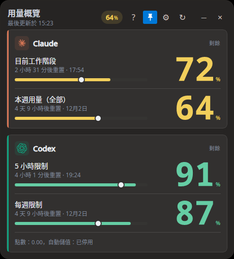
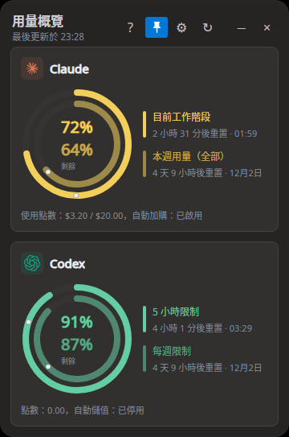
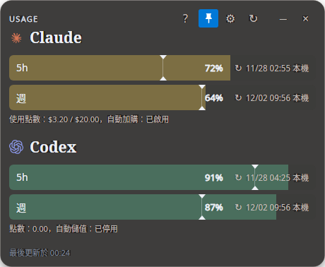

# 使用說明

[English](USER-GUIDE.md) · [简体中文（zh-cn）](USER-GUIDE.zh-CN.md)

本文件說明 [Claude Codex Usage Companion](../README.zh-TW.md) 的各項功能。安裝方式請參閱 [README](../README.zh-TW.md#安裝)。

## 桌面面板

面板為每個已啟用的供應商顯示一張卡片，Claude 在前，Codex 在後。各卡片顯示您選取的限制：

- Claude：**目前工作階段**與**本週用量（全部）**。
- Codex：**5 小時用量限制**與**每週用量限制**。

每項限制顯示剩餘百分比、重置倒數與本機重置時間。限制下方顯示點數資訊：Codex 顯示點數餘額與自動儲值資訊；Claude 顯示額外用量支出與每月上限。工具提示也會顯示相同資訊。

### 設計

在**設定 → 外觀 → 設計**中選取設計。

| 設計 | 說明 |
| --- | --- |
| **最新**（預設） | 每個供應商各有一張帶彩色邊緣的卡片。每項限制顯示細進度條與等寬字型的大字百分比。標題列顯示最後更新時間與徽章，與 Plasma 小工具的彈出視窗一致。 |
| **舊版（v0.1.5）** | v0.1.5 面板，使用帶標籤的 36 像素進度條。可設定欄位間距，並拖曳各卡片以調整高度。 |
| **圓環** | 每個供應商以一組圓環顯示。外環為目前或 5 小時限制，顏色較淡的內環為每週限制。面板較窄，且不顯示徽章。 |

| 最新（進度條） | 最新（圓環） | 舊版 |
| --- | --- | --- |
|  |  |  |

在最新設計中，**限制列**會將每項限制的名稱與重置時間放在同一列，讓面板更矮。

### 平均速度指標

平均速度指標標出在整個重置週期內平均使用額度時，進度條應該停在的位置。若進度條在指標之前結束，代表使用速度比平均快。將游標移至標記可查看此週期已過的比例。

- 最新設計：進度條上的圓點。
- 圓環設計：圓環上的圓點。
- 舊版設計：進度條上下邊緣的小刻度。

若要隱藏，請在設定的**用量**頁面取消勾選**在進度條上顯示平均速度指標**。

### 標題徽章

最新設計的標題列有一個顯示單一數值的徽章。將游標移至徽章可查看其顯示內容。按一下徽章可開啟選單並變更數值，程式會儲存變更。

| 徽章值 | 顯示內容 |
| --- | --- |
| **剩餘最少的限制**（預設） | 所有顯示中限制的最低剩餘百分比。 |
| **顯示中限制的平均值** | 所有顯示中限制的平均值。 |
| **Claude（剩餘最少）**、**Codex（剩餘最少）** | 單一供應商剩餘最少的限制。 |
| **Claude：目前工作階段**、**Claude：每週**、**Codex：5 小時**、**Codex：每週** | 單一限制，即使該列已隱藏也會顯示。 |
| **Claude：平均值**、**Codex：平均值** | 單一供應商顯示中限制的平均值。 |
| **隱藏** | 不顯示徽章。隱藏前程式會詢問確認。若要再次顯示，請使用**設定 → 外觀 → 標題徽章**。 |

**徽章平均方式**設定平均值如何合併各項限制：

- **簡單平均**（預設）：各項限制的權重相同。
- **依距離重置時間加權**：即將重置的限制權重較低。
- **依時間窗長度加權**：每週限制比 5 小時限制權重更高。
- **與平均速度的差距**：剩餘百分比減去時間窗尚未經過的比例，以帶正負號的百分點表示。大於 0 代表使用速度比平均慢。

### 視窗控制

標題列的控制項依序為鍵盤快速鍵、釘選、設定、重新整理、最小化與關閉。釘選按鈕可開啟或關閉**視窗永遠置頂**。

- 拖曳標題列以移動面板。程式會將位置儲存為 `custom`。
- 拖曳右下角以調整面板大小。
- 在舊版設計中，拖曳卡片底部的控點以調整高度。控點取得鍵盤焦點時，可使用向上與向下鍵。

主視窗的鍵盤快速鍵：

| 按鍵 | 動作 |
| --- | --- |
| `F1` | 顯示快速鍵清單。 |
| `S` | 開啟設定。 |
| `Ctrl+R` | 重新整理用量。 |
| `Esc` | 關閉視窗。 |

## 用量供應商

兩個供應商預設皆啟用。若要停止查詢某個供應商的用量，請在設定的**用量**頁面取消勾選**啟用 Claude 用量顯示**或**啟用 Codex 用量顯示**。這也會隱藏該供應商的卡片並清除其錯誤。

若要隱藏單一限制但繼續查詢，請在**顯示的用量限制**下取消勾選該項目。Codex **5 小時用量限制**預設隱藏。

錯誤會持續顯示，直到該供應商恢復正常。隱藏限制或另一個供應商更新都不會清除錯誤。

### Codex

程式會啟動本機 `codex app-server` 程序，並讀取 `account/rateLimits/read`。這需要 Codex CLI，請參閱[設定 Codex CLI](../README.zh-TW.md#設定-codex-cli)。

### Claude Code

Claude Code 沒有官方用量 API。程式會讀取 Claude Code 儲存在 `~/.claude/.credentials.json` 的 OAuth access token，並用它呼叫 Anthropic 未公開文件記載的用量端點。此端點可能隨時變更，恕不另行通知。

- 無論更新間隔為何，程式最多每 180 秒查詢一次 Claude 用量。
- Access token 過期時，程式會使用同一檔案中的 refresh token 更新它。兩個新 token 會以單次不可分割操作寫入，其餘欄位保持不變。
- 程式使用與 Claude CLI 相同的鎖定檔案，避免兩者同時變更 token。
- 程式絕不將 token 寫入記錄。

如果 refresh token 已過期或遭撤銷，程式會顯示錯誤。請執行 `claude` 重新登入。請參閱[設定 Claude Code（選用）](../README.zh-TW.md#設定-claude-code選用)。

## 系統匣

系統匣預設停用。若要啟用，請使用設定中**視窗與啟動**頁面的**系統匣**選項。

- 系統匣停用時，關閉面板會停止程式。
- 系統匣啟用時，關閉面板只會隱藏它。排定的更新與通知會繼續執行。

若要再次顯示面板，請選取系統匣圖示或**顯示視窗**，或再次啟動程式。面板會在上次的位置顯示已儲存的用量資料。

**系統匣圖示樣式**設定圖示：

| 樣式 | 圖示 |
| --- | --- |
| `original`（預設） | 程式圖示。 |
| `claude-current-session` | Claude 目前工作階段的剩餘百分比。 |
| `claude-weekly-session` | Claude 每週剩餘百分比。 |
| `codex-session` | Codex 5 小時剩餘百分比。若無此限制，則顯示 Codex 每週剩餘百分比。 |

數字樣式在深色背景上顯示粗體七段數字，不含百分比符號。

系統匣選單有下列項目：

- **顯示視窗**
- **重新整理用量**
- **視窗永遠置頂**
- **登入時自動啟動**
- **檢查更新**
- **自動檢查更新**
- **設定**
- **鍵盤快速鍵**
- **結束**

系統匣工具提示以每行一項限制的方式顯示用量與最後更新時間，例如：

```text
Claude Codex Usage Companion
[Claude] Current: 62% remaining (Resets at ...)
[Claude] Weekly: 80% remaining (Resets at ...)
[Codex] Weekly: 45% remaining (Resets at ...)
Last updated at 14:05
```

## 通知

在設定的**通知**頁面設定通知。兩種類型預設皆停用。

- **剩餘用量低於門檻時發出通知**：5 小時或每週剩餘用量低於門檻時，程式傳送一次通知。門檻範圍為 1–100%，預設為 20。用量回到門檻或以上後，可再次觸發警示。
- **用量重置時發出通知**：用量更新確認新的重置週期時，程式會傳送通知。

通知使用 `notify-send`。更新檢查也會傳送通知，請參閱[更新](#更新)。

## 用量記錄

用量記錄預設停用。在設定的**記錄**頁面啟用後，程式會將每次成功更新與更新錯誤附加到檔案。

預設檔案為 `${XDG_STATE_HOME:-$HOME/.local/state}/claude-codex-usage-companion/usage-history.csv`。相對路徑以程式的 XDG 狀態目錄為起點。

| 格式 | 內容 |
| --- | --- |
| `txt` | 每行一筆索引鍵／值記錄。 |
| `csv`（預設） | 一列標頭，之後每筆記錄各佔一列。 |
| `jsonl` | 每行一個 JSON 物件。 |

變更格式時，程式會一併變更副檔名。

每筆記錄包含下列欄位：

- 更新時間戳記。
- 供應商：`claude` 或 `codex`。
- 成功或錯誤狀態。
- 5 小時與每週剩餘百分比及重置時間。
- 可用的重置點數。
- 更新錯誤（若有）。

## 更新

程式會在 GitHub 檢查較新的穩定版本。請使用設定的**更新**頁面或系統匣選單。

- **自動檢查更新（啟動時及每天）**預設啟用。程式在啟動時及每 24 小時檢查一次。
- **檢查更新**會立即檢查，即使已關閉自動檢查。
- 有新版本時，設定會顯示**安裝更新**與**開啟版本頁面**。從系統匣檢查會顯示通知。若程式可安裝更新，通知會有**立即安裝**按鈕。
- **自動下載並安裝更新**會在可行時直接安裝新版本，不再詢問。此選項預設關閉，且需要啟用自動檢查。

在您選取**立即安裝**或**安裝更新**，或啟用自動安裝之前，程式不會下載任何檔案。

### 進度

下載與安裝更新時，程式會顯示各階段：簽章檢查、下載、套件檢查與安裝。下載時會顯示已接收的 MB 數與百分比。

- 設定中的按鈕下方會顯示進度條與狀態列。
- 從通知安裝或自動安裝時，會以一則桌面通知顯示進度。安裝完成後，同一則通知會顯示結果。

### 重新安裝

您可以再次安裝目前版本，例如修復安裝內容。

在設定的**更新**頁面選取**重新安裝最新版本**。程式會檢查並安裝最新版本。若有較新的版本，則會安裝該版本。

只有目前安裝方式可安裝套件時，才會顯示此按鈕。請參閱[安裝行為](#安裝行為)。重新安裝與更新使用相同的驗證方式。若該版本沒有適用於目前安裝方式的套件，設定會顯示**開啟版本頁面**。

### 安裝行為

實際行為取決於程式的安裝方式。設定會顯示對應安裝方式的說明。

| 安裝方式 | 行為 |
| --- | --- |
| 位於可寫入資料夾（例如 `~/.local/bin`）的可攜式封存檔 | 程式下載更新、取代自身檔案並重新啟動，不會要求密碼。 |
| Debian 套件 | 程式在背景下載更新，再以通知請您安裝。選取**立即安裝**並輸入管理員密碼後，程式執行 `pkexec apt-get install`，然後重新啟動。 |
| Snap | 程式無法取代 snapd 管理的檔案。請開啟版本頁面手動更新。 |
| Codex 外掛程式 | 外掛程式的更新由 Codex 管理。 |

### 驗證

更新套件必須通過兩項檢查，程式才會安裝：

1. `SHA256SUMS` 檔案帶有專案發行金鑰的有效簽章。程式內建公開金鑰。
2. 套件的 SHA-256 雜湊值與已簽署 `SHA256SUMS` 中的項目相符。

v0.2.1 之前的版本沒有簽章，因此程式不會自動安裝。

下載檔案存放在 `${XDG_CACHE_HOME:-$HOME/.cache}/claude-codex-usage-companion/updates`。程式只保留最新的下載。更新失敗時，通知會提供版本頁面連結，程式也會將錯誤寫入記錄。

若要手動驗證版本，請將[公開金鑰](../packaging/update-signing-key.pub.pem)存到下載資料夾，然後執行：

```bash
openssl dgst -sha256 -verify update-signing-key.pub.pem -signature SHA256SUMS.sig SHA256SUMS
sha256sum --check --ignore-missing SHA256SUMS
```

## Plasma 6 小工具

**Claude Codex Usage** 小工具會在 Plasma 面板或桌面顯示四項限制。選取小工具可開啟彈出視窗，查看重置時間、點數、更新狀態與錯誤。

| 設計 | 面板 | 展開彈出視窗 |
| --- | --- | --- |
| 最新（預設） |  |  |
| 舊版 |  |  |

若要新增小工具：

1. 在 Plasma 桌面或面板上按滑鼠右鍵。
2. 選取**新增元件**。
3. 搜尋 `Claude Codex Usage`。
4. 將小工具拖曳到面板或桌面。

`.deb` 已包含小工具。使用 snap 或可攜式封存檔時，請安裝 [Plasma 小工具套件](../README.zh-TW.md#plasma-小工具套件)。

小工具會呼叫程式的 `status --json` 命令。程式必須位於 `PATH` 中。憑證讀取與所有網路存取均由程式處理。


設定頁面有下列選項：

| 選項 | 值 | 效果 |
| --- | --- | --- |
| **Design** | Latest (default), Previous | 小工具的外觀。**Percentages**、**Panel**、**Warn below**、**Critical below**、**Popup badge** 與 **Show credits** 僅適用於最新設計。 |
| **Style** | Radial meters, Meter strips | 在面板顯示圓環或進度條。 |
| **Update every** | 1–60 minutes | 小工具向程式查詢用量的頻率。 |
| **Percentages** | Remaining (default), Used | 顯示各項限制的剩餘量或已用量。顏色一律依剩餘量決定。 |
| **On click** | Open the popup (default), Open the companion app | 點選面板小工具時的動作。 |
| **Panel** | Two checkboxes | 僅顯示剩餘最少（或已用最多）的限制。顯示或隱藏簡短標籤。 |
| **Warn below** 與 **Critical below** | 1–100% left (defaults 70% and 40%) | 限制低於警告門檻時顯示琥珀色，低於嚴重門檻時顯示紅色。 |
| **Reset time** | Countdown and time (default), Countdown, Time | 重置時間的顯示方式。選取 **Time** 時，超過一天後才重置的限制會包含星期。 |
| **Clock** | System default, 12-hour, 24-hour | 重置時間與最後更新時間的時鐘格式。 |
| **Tooltip** | Three checkboxes | 顯示剩餘最少（或已用最多）的限制、重置時間與最後更新時間。 |
| **Limits** | Four checkboxes | 面板與彈出視窗顯示的限制。 |
| **Popup badge** | Most-used limit (default), Average of shown limits, Claude's most-used limit, Codex's most-used limit, Hidden | 彈出視窗標題徽章的數值。 |
| **Popup** | Two checkboxes | 顯示點數列與平均速度標記。 |

水平面板中的指示器會並排顯示，垂直面板中則會上下排列。

## CLI

範例使用 `claude-codex-usage` 別名。若沒有此別名，請使用 `claude-codex-usage-companion`。

| 命令 | 動作 |
| --- | --- |
| `claude-codex-usage gui` | 啟動桌面面板；若已在執行，則顯示面板。 |
| `claude-codex-usage status` | 輸出目前的限制。 |
| `claude-codex-usage status --json` | 以 JSON 輸出目前的限制。 |
| `claude-codex-usage watch --interval 30` | 每 30 秒重新整理終端機。 |
| `claude-codex-usage config` | 輸出設定路徑與實際生效的設定。 |

輸出先顯示 Claude，再顯示 Codex。JSON 輸出的結構如下：

```json
{"claude": {"state": ..., "error": ...}, "codex": {"state": ..., "error": ...}}
```

供應商停用時，輸出不會包含其索引鍵。

若要停用 ANSI 色彩，請設定 `NO_COLOR=1` 或使用 `--no-color`。

## Codex hooks

[Codex 外掛程式](../README.zh-TW.md#codex-外掛程式)會新增兩個 Codex hooks：

- `SessionStart`：Codex 工作階段開始或繼續時執行。
- `Stop`：Codex 完成一個回合時執行。

每個 hook 都會通知執行中的面板重新整理用量。面板未執行時，hook 會啟動它。

同一時間只會執行一個面板程序。由外掛程式啟動時，程式會將設定存放在 `PLUGIN_DATA`。

## 設定

選取面板標題列或系統匣選單中的 **⚙ 設定**。設定包含下列頁面：

| 頁面 | 設定項目 |
| --- | --- |
| **用量** | 啟用各供應商、顯示的限制、平均速度指標、更新間隔（1–60 分鐘，預設為 1）。 |
| **外觀** | 語言、主題、設計、限制列、標題徽章、徽章平均方式、面板字體大小（80–150%）、背景顏色、欄位間距（僅舊版設計）。 |
| **視窗與啟動** | 視窗位置、永遠置頂、工作列圖示、系統匣與系統匣圖示樣式、登入時啟動、啟動時最小化。 |
| **通知** | 低用量警示、重置通知、警示門檻。 |
| **日期與時間** | 重置日期時間格式、最後更新日期時間格式。 |
| **記錄** | 用量記錄、記錄檔路徑、記錄格式。 |
| **更新** | 自動檢查、自動安裝、檢查、安裝與重新安裝按鈕、更新進度、版本與專案連結。 |

- **確定**會儲存變更並關閉設定。
- **套用**會儲存變更並保持設定開啟。
- **取消**會捨棄尚未套用的變更。
- **還原預設值**會先詢問確認，再還原表單中的所有值。選取**確定**或**套用**以儲存。
- `Ctrl+S` 儲存設定。`Esc` 關閉設定。若有未儲存的變更，程式會先詢問是否捨棄。

外觀與位置變更會立即顯示。**取消**會還原已儲存的值。開啟設定時會回到上次使用的頁面。

### 選項詳情

- **主題**：`system`（預設）會跟隨桌面的深淺色偏好。也可選取 `dark` 或 `light`。
- **語言**：首次執行時，程式依系統文化特性選擇語言。繁體中文文化特性使用 `zh-tw`，簡體中文使用 `zh-cn`，其他文化特性皆使用 `en-US`。
- **背景顏色**：`#RRGGBB` 或 `#AARRGGBB`。留白使用主題顏色。
- **視窗位置**：九種預設位置或 `custom`。預設位置使用桌面工作區域，避免面板覆蓋保留空間的工作列。
- **登入時自動啟動**：建立 `${XDG_CONFIG_HOME:-$HOME/.config}/autostart/claude-codex-usage-companion.desktop`。啟用時，**最小化視窗**會讓程式啟動時隱藏面板。
- **重置日期時間格式**與**最後更新日期時間格式**：選取預設格式，或輸入 .NET 日期時間格式字串。大寫 `D` 是日期代碼。輸入時，預覽會檢查格式。格式無效時，**確定**與**套用**會停用。

| 格式 | 預設選項 |
| --- | --- |
| 重置日期時間 | `MMM D`（預設）、`MMM D HH:mm`、`yyyy-MM-dd`、`yyyy-MM-dd HH:mm` |
| 最後更新 | `HH:mm`（預設）、`HH:mm:ss`、`MMM D HH:mm`、`yyyy-MM-dd HH:mm` |

### 設定檔

預設設定檔為：

```text
${XDG_CONFIG_HOME:-$HOME/.config}/claude-codex-usage-companion/settings.json
```

```json
{
  "showClaudeSession": true,
  "showClaudeWeekly": true,
  "showCodexFiveHour": false,
  "showCodexWeekly": true,
  "enableClaudeUsage": true,
  "enableCodexUsage": true,
  "enableSystemTray": false,
  "trayIconStyle": "original",
  "showTaskbarIcon": true,
  "enableAutoUpdateCheck": true,
  "startOnBoot": false,
  "minimizeOnStart": false,
  "language": "en-US",
  "theme": "system",
  "overlayDesign": "latest",
  "resetTimeOnNameRow": false,
  "headerBadge": "lowest",
  "confirmHideBadge": true,
  "badgeAverage": "plain",
  "settingsPage": "usage",
  "backgroundColor": "",
  "percentageTimeSpacing": 16,
  "labelPercentageSpacing": 128,
  "enableLowUsageAlert": false,
  "lowUsageAlertThresholdPercent": 20,
  "notifyOnReset": false,
  "enableUsageLogging": false,
  "usageLogFilePath": "/home/you/.local/state/claude-codex-usage-companion/usage-history.csv",
  "usageLogFormat": "csv",
  "position": "right-bottom",
  "opacity": 1.0,
  "margin": 16,
  "alwaysOnTop": true,
  "refreshIntervalSeconds": 60,
  "resetDateTimeFormat": "MMM D",
  "lastUpdatedDateTimeFormat": "HH:mm"
}
```

| 設定鍵 | 值 |
| --- | --- |
| `language` | `en-US`, `zh-tw`, `zh-cn`。也接受舊版值 `auto` 與 `en`。 |
| `theme` | `system`, `dark`, `light` |
| `overlayDesign` | `latest`, `previous`, `rings` |
| `headerBadge` | `lowest`, `average`, `claude`, `claude-session`, `claude-weekly`, `claude-average`, `codex`, `codex-five-hour`, `codex-weekly`, `codex-average`, `hidden` |
| `badgeAverage` | `plain`, `time-to-reset`, `window-length`, `pace` |
| `trayIconStyle` | `original`, `claude-current-session`, `claude-weekly-session`, `codex-session` |
| `position` | `left-top`, `middle-top`, `right-top`, `left-center`, `middle-center`, `right-center`, `left-bottom`, `middle-bottom`, `right-bottom`, `custom`。也接受 `top-left` 等舊版值。 |
| `settingsPage` | `usage`, `appearance`, `window`, `notifications`, `dateTime`, `logging`, `updates` |
| `usageLogFormat` | `txt`, `csv`, `jsonl` |
| `opacity` | `0.5`–`1.0` |
| `margin` | `0`–`64` 像素 |
| `refreshIntervalSeconds` | `60`–`3600` |
| `labelPercentageSpacing` | `0`–`300` 像素（舊版設計） |
| `percentageTimeSpacing` | `0`–`64` 像素（舊版設計） |

### 環境變數

| 變數 | 用途 |
| --- | --- |
| `CODEX_CLI_PATH` | `codex` 不在 `PATH` 中時，指定其絕對路徑。 |
| `CLAUDE_CLI_PATH` | `claude` 不在 `PATH` 中時，指定其絕對路徑。 |
| `CLAUDE_CREDENTIALS_PATH` | Claude `.credentials.json` 檔案的絕對路徑。 |
| `NO_COLOR` | 停用 CLI 的 ANSI 色彩。 |
